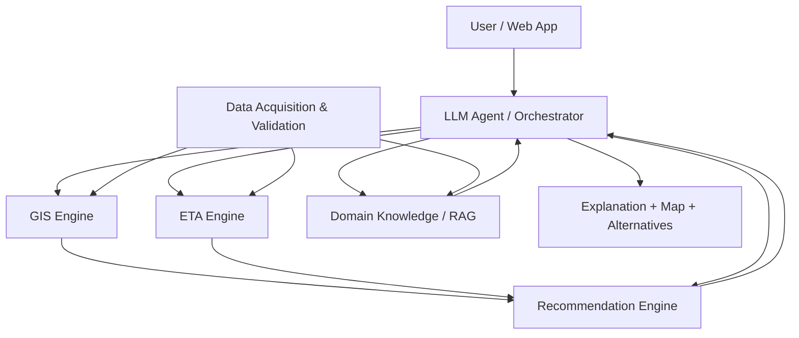

# GarbageGo — System Design Document

> **Version:** v0.1  
> **Status:** Initial Draft / Proposed  
> **Last Updated:** 2026-10-20  
> **Project Type:** Domain AI Agent / AIoT / GIS / ETA Prediction  
> **Scope:** 臺中市垃圾清運收運點查詢與到點可行性推薦

## 1. Project Overview

### 1.1 Background

使用者需要在垃圾車抵達前走到適合的收運點。單純知道「最近的收運點」或「垃圾車預估抵達時間」，不一定能判斷現在出發是否來得及。

GarbageGo 預計整合垃圾車動態資料、收運點資料、GIS 空間分析、ETA 估計與使用者步行時間，提供具備原因說明及備案的推薦。

### 1.2 Core Research Question

> **使用者現在應該前往哪一個收運點，才最可能趕上垃圾車？**

### 1.3 Goals

1. 理解使用者的自然語言查詢與位置需求。
2. 搜尋附近且符合清運條件的候選收運點。
3. 估計垃圾車抵達候選點的時間，以及使用者到達該點的步行時間。
4. 根據時間餘裕、資料新鮮度及預測不確定性評估可行性。
5. 推薦適合的收運點，並在必要時提供備案。
6. 以地圖及繁體中文說明推薦理由與資料限制。

### 1.4 Non-Goals (v0.1)

- 不承諾涵蓋臺中市所有路線或收運點。
- 不承諾提供秒級即時定位或保證垃圾車準時抵達。
- 不預先假定必須訓練 Deep Learning 模型。
- 不以 LLM 自行推測 GPS、步行時間或 ETA 作為可靠數值來源。
- 不在資料可行性確認前承諾上線服務或實際推播。

## 2. User Scenarios & Requirements

### 2.1 Primary Scenario

**使用者提問：**「我現在附近哪裡可以丟垃圾？」

預期流程：

1. 取得使用者授權的位置，必要時詢問清運需求。
2. 查詢附近候選收運點及其清運時段。
3. 取得可用的垃圾車動態資訊與資料更新時間。
4. 估計使用者步行時間及垃圾車到點 ETA。
5. 計算時間餘裕並判斷可行性。
6. 輸出推薦點、理由、風險與備選點。

### 2.2 Alternative Scenarios

- **垃圾車已離開：**排除已無法趕上的候選點，搜尋後續收運點或其他路線。
- **GPS 過期或缺失：**顯示資料不足，改以明確標示的排程資訊提供保守建議。
- **使用者未授權定位：**允許手動輸入地址或指定地點（是否實作待確認）。
- **沒有可行候選點：**明確告知目前無法確認可趕上的方案，不製造虛假的推薦。

### 2.3 Initial Functional Requirements

| ID | Requirement | Status |
|---|---|---|
| FR-01 | 自然語言查詢及意圖辨識 | Planned |
| FR-02 | 使用者位置輸入與權限處理 | Planned |
| FR-03 | 附近收運點 GIS 查詢 | Planned |
| FR-04 | 清運路線、時段與車輛資料整合 | Planned |
| FR-05 | 垃圾車到點 ETA 估計 | Planned |
| FR-06 | 使用者步行時間估計 | Planned |
| FR-07 | 候選點可行性評分與推薦 | Planned |
| FR-08 | 替代收運點搜尋 | Planned |
| FR-09 | 地圖與文字結果呈現 | Planned |
| FR-10 | 資料更新時間與不確定性提示 | Planned |

### 2.4 Non-Functional Requirements

- **Correctness:** 清楚區分預定時間、估計時間及實際觀測時間。
- **Explainability:** 每筆推薦應可追溯至資料與計算依據。
- **Resilience:** 外部資料缺失或服務失敗時提供合理降級行為。
- **Privacy:** 使用者定位僅在必要且經授權的範圍內使用。
- **Maintainability:** 模組職責清楚，外部服務可替換。
- **Testability:** ETA、GIS 與推薦邏輯能以固定測試資料驗證。

## 3. Proposed System Architecture

> **Status:** Proposed；以下為邏輯模組，不代表已決定實際部署方式或程式框架。



### 3.1 Module Responsibilities

| Module | Responsibility | Boundary / Notes | Status |
|---|---|---|---|
| LLM Agent / Orchestrator | 意圖理解、工作流程協調、工具調用、結果說明 | 不直接捏造 GIS / ETA 數值 | Planned |
| Data Acquisition | 串接、驗證、標準化外部資料 | 記錄來源、時間戳與失敗原因 | Planned |
| GIS Engine | 收運點搜尋、空間關係與路徑分析 | 步行路徑應使用適當路網而非僅直線距離 | Planned |
| ETA Engine | 估計車輛到達指定收運點的時間 | 模型依資料品質選型；需提供不確定性 | Planned |
| Recommendation Engine | 計算可行性、排序、備案 | 不只依最近距離排序 | Planned |
| Domain Knowledge / RAG | 檢索清運規則、例外與來源 | RAG 不取代 ETA 預測模型 | Planned |
| User Interface | 文字對話、地圖、風險提示 | UI 技術待選型 | Planned |

## 4. Data Sources & Data Flow

### 4.1 Candidate Data Sources (Not Yet Validated)

| Source | Intended Use | Verification Required | Status |
|---|---|---|---|
| 臺中市垃圾車動態 OpenData（候選：<https://data.gov.tw/dataset/83558>） | 車輛位置、時間、速度等資訊 | API 可用性、欄位、座標系統、更新頻率、授權 | To Verify |
| 臺中市定時定點清運資料（候選：<https://data.gov.tw/dataset/84004>） | 收運點、路線與排程 | 站點識別、時段、車輛關聯、更新週期、授權 | To Verify |
| 地圖／路徑服務（待選） | 步行路網與時間估計 | API 配額、費用、服務條款、涵蓋範圍 | To Decide |
| 歷史 GPS 軌跡（待確認） | ETA 模型訓練與評估 | 是否可取得、資料量、頻率、保存與合法性 | To Verify |
| 清運規則與官方公告（待整理） | Domain Knowledge / RAG | 來源權威性、有效日期、例外處理 | To Verify |

**資料可行性風險：**若動態資料更新間隔過長，可能無法可靠重建短暫停靠時間，也可能限制即時 ETA 精度。必須先進行資料盤點與實測，不可預設資料足夠。

### 4.2 Conceptual Data Flow

1. 使用者輸入查詢與位置。
2. Data Acquisition 取得清運點、排程及可用動態資料。
3. 資料驗證與標準化：時間、座標、路線／車輛／站點關聯。
4. GIS Engine 產生候選點與步行時間。
5. ETA Engine 對候選點估計車輛到達時間。
6. Recommendation Engine 計算時間餘裕、可行性與備案。
7. LLM Agent 根據工具結果生成有依據的說明。
8. UI 呈現地圖、推薦、時間戳與風險提示。

## 5. Core Decision Logic (Conceptual)

### 5.1 Time Feasibility

對每個候選收運點 `s`：

```text
slack(s) = truck_ETA(s) - walking_time(s) - safety_buffer(s)
```

其中：

- `truck_ETA(s)`：垃圾車距離抵達候選點的預估剩餘時間。
- `walking_time(s)`：使用者步行至候選點的預估時間。
- `safety_buffer(s)`：用於吸收資料延遲、預測誤差及行走差異的緩衝時間。
- `slack(s)`：扣除緩衝後的剩餘時間；正值不等於保證能趕上。

**初步規則：**先排除不符合清運條件或已明確錯過的候選點，再考量時間餘裕、風險、步行負擔與資料品質進行排序。實際權重與閾值需透過實驗決定。

### 5.2 Recommendation Pseudocode (Draft)

```text
01  INPUT: user_location, user_request, query_time
02  intent <- understand_request(user_request)
03  stops <- find_candidate_stops(user_location, intent)
04  IF stops is empty: RETURN no_candidate_result
05  live_data <- get_truck_data_with_timestamp()
06  FOR EACH stop IN stops:
07      walk <- estimate_walking_time(user_location, stop)
08      eta <- estimate_truck_arrival(stop, live_data)
09      quality <- assess_data_freshness_and_uncertainty(eta, live_data)
10      IF required data is insufficient:
11          mark stop as uncertain; CONTINUE
12      slack <- eta.remaining_minutes - walk.minutes - safety_buffer(quality)
13      evaluate feasibility and explanation for stop
14  rank feasible candidates using defined criteria
15  IF no feasible candidates: search alternatives or report uncertainty
16  RETURN ranked recommendations, alternatives, evidence, timestamps
```

> 上述為研究與設計用 Pseudocode，不代表已完成或驗證演算法。

## 6. ETA Approach & Model Selection

**目前不預先指定模型。** 先完成資料可行性評估，再選擇適當基準與進階方法。

### 6.1 Candidate Baselines

- **Schedule Baseline:** 依官方預定收運時間推估。
- **Distance / Speed Baseline:** 使用路線距離與可用速度資料估計。
- **Historical Statistical Baseline:** 使用同路線、相近時段的歷史行車時間（需有足夠資料）。

### 6.2 Candidate Advanced Models

- Regression / Tree-based ML（視特徵與資料量評估）。
- Sequence Models（僅在具備足夠且可靠的連續軌跡資料時考慮）。
- Hybrid Model（排程、即時觀測、歷史資料與規則整合）。

### 6.3 Model Constraints

- 不得將未取得的歷史資料視為已存在。
- 模型需明確區分訓練、驗證與測試資料，並避免時間洩漏。
- 對過期 GPS、缺失資料、路線異常及節假日情況提供降級策略。
- 輸出應包含 ETA、資料時間及可行時的不確定性估計。

## 7. Domain Knowledge & RAG

可能納入：

- 一般垃圾與資源回收的收運規則。
- 不同清運路線、時段、停靠點的規則與例外。
- 停收、改線、臨時公告及特殊日期資訊。
- 官方資料欄位說明與資料使用限制。

RAG 的任務是**檢索與引用規則**，不是取代 GIS 路徑計算或 ETA 模型。正式建置前需確認文件來源、更新機制、索引方式與引用格式。

## 8. Evaluation Plan (Proposed)

| Evaluation Target | Candidate Metrics | Comparison / Method |
|---|---|---|
| ETA Accuracy | MAE、RMSE、誤差分布 | Schedule / Distance-Speed / Proposed Model |
| Recommendation Feasibility | 趕上率、誤判率、備案有效率 | 最近點策略 vs 時間可行性策略 |
| GIS & Walking | 路線合理性、步行時間誤差 | 路網估計與實際／可信參考資料比較 |
| System Reliability | API 失敗處理、資料過期識別、回應時間 | 測試情境與故障注入 |
| Agent Quality | 工具調用正確性、資訊可追溯性、錯誤說明 | 測試問題集與人工檢核 |

**實驗原則：**僅在取得資料與完成實驗後填入實際數值；不得將預期成果當作已驗證結果。

## 9. MVP Scope & Milestones

### Phase 0 — Research & Feasibility (Planned)

- [ ] 確認官方資料集可取得、欄位、更新頻率與授權。
- [ ] 確認路線、車輛與收運點能否可靠對應。
- [ ] 決定 MVP 區域及少量代表性路線。
- [ ] 蒐集文獻並建立 Article Summary Table。
- [ ] 透過 Superpowers Brainstorming 確認設計與技術選型。

### Phase 1 — Core Prototype (Planned)

- [ ] 收運點與 GIS 查詢。
- [ ] 排程或簡單 ETA Baseline。
- [ ] 步行時間與時間餘裕計算。
- [ ] 候選點推薦與備案。
- [ ] 最小可行的地圖及文字介面。

### Phase 2 — Agent & Model Improvement (Planned)

- [ ] LLM 工具調用與可解釋結果。
- [ ] 視需要加入 RAG。
- [ ] 依資料品質導入或改善 ETA 模型。
- [ ] 增加異常與資料過期處理。

### Phase 3 — Evaluation & Delivery (Planned)

- [ ] Baseline 與改良方法比較。
- [ ] 完成實驗、限制分析與報告。
- [ ] 完善 README、DESIGN、Proposal、簡報與 Demo。

## 10. Technology Decisions (Open)

| Decision | Current State | Selection Criteria |
|---|---|---|
| Backend framework | Undecided | 熟悉度、API 開發效率、ML 整合、部署 |
| Frontend / Map | Undecided | 地圖互動、RWD、授權與維護 |
| Database / Spatial DB | Undecided | 空間查詢、資料規模、部署成本 |
| ETA modeling stack | Undecided | 資料品質、Baseline 成效、可解釋性 |
| Walking route provider | Undecided | 台中涵蓋率、步行路網、費用與配額 |
| LLM provider / orchestration | Undecided | Tool Calling、成本、測試能力 |
| RAG / vector store | Undecided | 是否確有檢索需求、資料量、維護成本 |
| Deployment | Undecided | Demo 需求、成本、API 金鑰安全 |

**Decision Rule:** 重大技術選型先進行 Brainstorming，確認後再更新本表及對應 Specification；遵循 KISS / YAGNI，避免過早引入大型依賴。

## 11. Risks & Open Questions

1. **Data Availability:** 官方即時資料是否穩定可用？是否可長期保存歷史觀測？
2. **Update Latency:** GPS 更新頻率是否足以支援到點預測？
3. **Entity Matching:** 路線、車輛、站點與時刻能否可靠關聯？
4. **Ground Truth:** 如何取得真實到點時間供 ETA 評估？
5. **Walking Accuracy:** 如何取得可靠的步行路線與時間？
6. **Cold Start:** 無歷史資料的路線如何估計 ETA？
7. **Fallback:** 資料缺失或不確定時，如何避免錯誤推薦？
8. **Privacy:** 如何處理定位權限、記錄及資料保存？
9. **Research Gap:** 如何與既有垃圾車查詢與 ETA 服務明確區隔？
10. **MVP Feasibility:** 哪些行政區與路線最適合先驗證？

## 12. Documentation & Development Workflow

本文件記錄系統設計與決策；開發行為以根目錄 `AGENTS.md` 為準。

```text
Read AGENTS.md + DESIGN.md
          ↓
Understand requirements / inspect specs
          ↓
Superpowers Brainstorming (new features / major changes)
          ↓
User confirms design
          ↓
Update docs/specs/ + DESIGN.md
          ↓
Superpowers writing-plans → docs/plans/
          ↓
TDD / Implementation
          ↓
Verification / Review
          ↓
Update documentation and implementation status
```

- **`README.md`:** 專案介紹、安裝、執行與 Demo。
- **`docs/specs/`:** 詳細需求與驗收條件。
- **`docs/plans/`:** Superpowers 開發計畫。
- **`docs/architecture/`:** 細部架構圖、Flowchart 與 Pseudocode。
- **`docs/research/`:** 論文、資料來源及研究紀錄。
- **`docs/proposal/`:** 期末專題 Proposal 內容。

## 13. Implementation Status

| Area | Status | Notes |
|---|---|---|
| Requirements | Draft | 待 Brainstorming 與使用者確認 |
| Architecture | Proposed | 僅為邏輯架構 |
| Data Sources | To Verify | 尚未完成實際 API 驗證 |
| GIS Engine | Planned | 尚未實作 |
| ETA Engine | Planned | 尚未選型或訓練 |
| Recommendation Engine | Planned | 僅有概念性規則 |
| LLM Agent | Planned | 尚未實作 |
| RAG | Planned / Optional | 依實際需求確認 |
| UI / Map | Planned | 尚未實作 |
| Evaluation | Planned | 尚無實驗結果 |

## 14. Change Log

| Version | Date | Changes |
|---|---|---|
| v0.1 | 2026-10-20 | 建立初始設計草案；定義研究目標、邏輯架構、資料需求、候選演算法、評估方向與待決策事項 |
