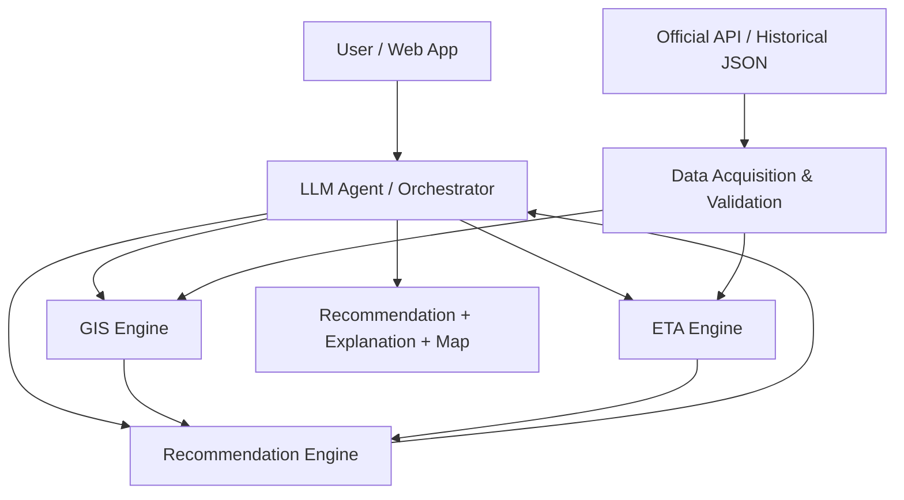

# GarbageGo

臺中市垃圾清運收運點查詢與到點可行性推薦系統。

GarbageGo 是一個結合 Domain AI Agent、GIS、垃圾車資料與 ETA Prediction 的垃圾清運推薦系統。系統的目標不是只找最近的收運點，而是判斷使用者現在出發後，是否還有機會趕上垃圾車。

> **Status:** Proposal / Initial Design
>
> 目前專案正在進行資料可行性分析與系統設計，尚未完成正式服務或即時推薦功能。

## Problem

使用者只知道最近的收運點，不代表現在走過去還來得及。垃圾車的預定時間也不一定等於實際抵達時間，GPS 資料還可能延遲、缺失或不夠精確。

GarbageGo 要回答的核心問題是：

> **使用者現在應該前往哪一個收運點，才最可能趕上垃圾車？**

## Proposed Solution

GarbageGo 將整合下列資料與分析能力：

- 使用者位置與自然語言查詢
- 附近收運點與清運時段
- 垃圾車動態資料
- 歷史 JSON 資料
- GIS 距離與步行時間分析
- 垃圾車 ETA 估計
- 候選收運點可行性評估
- 推薦理由、風險與備選方案

LLM Agent 負責理解使用者需求、協調工具與說明結果；GIS、ETA 與 Recommendation Engine 負責產生實際計算結果。LLM 不直接猜測 GPS、距離或 ETA。

## Main Scenario

使用者詢問：

> 「我現在附近哪裡可以丟垃圾？」

系統預計執行以下流程：

1. 取得使用者授權的位置。
2. 搜尋附近且符合清運條件的候選收運點。
3. 取得垃圾車動態資料與資料時間。
4. 估計使用者走到各收運點所需的時間。
5. 估計垃圾車到達各收運點的 ETA。
6. 計算使用者是否還有足夠時間抵達。
7. 顯示推薦點、推薦理由、資料風險與備選點。

## System Architecture



主要模組如下：

| Module | Responsibility | Status |
|---|---|---|
| Data Acquisition | 取得官方 API 與歷史 JSON 資料 | Planned |
| Data Validation | 檢查時間、座標、欄位與資料新鮮度 | Planned |
| GIS Engine | 搜尋附近收運點與估計步行時間 | Planned |
| ETA Engine | 估計垃圾車到達時間與不確定性 | Planned |
| Recommendation Engine | 計算可行性、排序與備選方案 | Planned |
| LLM Agent / Orchestrator | 理解需求、協調工具與說明結果 | Planned |
| User Interface | 呈現地圖、推薦結果與風險提示 | Planned |

完整設計請參考 [DESIGN.md](DESIGN.md)。

## Data Sources

| Data | Intended Use | Status |
|---|---|---|
| [臺中市垃圾清運及資源回收車動態資訊](https://data.gov.tw/dataset/83558) | 車輛位置、路線、時間與速度資料 | To Verify |
| 歷史 JSON 資料 | ETA 統計、模型訓練與評估 | Available / To Validate |
| 收運點與清運時段資料 | 候選收運點查詢與清運條件判斷 | To Verify |
| 地圖／路徑服務 | 使用者步行時間估計 | To Decide |

官方資料頁面目前標示提供 JSON 資料，主要欄位包含 `lineid`、`car`、`time`、`location`、`X`、`Y`、`SpeedValue` 與 `OverSpeed`，更新頻率為每 10 分鐘。

歷史資料與 API 使用相同格式，預計使用同一套 Data Ingestion 與資料模型處理。系統應區分：

- `observed_at`：資料描述的時間。
- `collected_at`：系統實際收到或匯入資料的時間。

由於資料更新間隔、資料延遲、座標品質與車輛停留狀態仍需驗證，系統不會把 ETA 描述成保證時間。

## Core Decision Logic

對每個候選收運點計算時間餘裕：

```text
slack = truck_ETA - walking_time - safety_buffer
```

其中：

- `truck_ETA`：垃圾車到達候選收運點的預估剩餘時間。
- `walking_time`：使用者步行到候選收運點的預估時間。
- `safety_buffer`：吸收資料延遲、預測誤差與行走差異的緩衝時間。
- `slack`：扣除風險後的剩餘時間。

`slack > 0` 不代表一定能趕上，只代表在目前資料與假設下具備可行性。

推薦時還需要考慮：

- 收運點是否在有效清運時段。
- 垃圾車是否已經離開。
- ETA 的不確定性。
- GPS 或動態資料是否過期。
- 是否有其他可行的替代收運點。

## MVP Scope

第一版預計聚焦下列功能：

- 附近收運點搜尋。
- 官方垃圾車資料匯入。
- 歷史 JSON 資料匯入。
- 使用者步行時間估計。
- 垃圾車 ETA Baseline。
- 時間餘裕計算。
- 可行收運點推薦。
- 備選收運點搜尋。
- 資料時間與不確定性提示。

### Non-Goals for v0.1

- 不承諾涵蓋臺中市所有路線或收運點。
- 不承諾提供秒級即時定位。
- 不保證垃圾車準時抵達。
- 不預先假定必須使用 Deep Learning。
- 不讓 LLM 自行推測 GPS、步行時間或 ETA。
- 不在資料可行性確認前承諾正式上線或推播服務。

## Current Status

| Area | Status | Notes |
|---|---|---|
| Requirements | Draft | 待進一步確認需求與驗收條件 |
| Architecture | Proposed | 已建立邏輯架構，部署方式尚未定案 |
| Official Data Verification | To Verify | 需要確認欄位、座標、更新頻率與資料品質 |
| Historical JSON Import | Planned | 歷史資料格式與 API 相同，尚未建立匯入流程 |
| GIS Engine | Planned | 尚未實作 |
| ETA Engine | Planned | 尚未選型或訓練 |
| Recommendation Engine | Planned | 目前只有概念性規則 |
| LLM Agent | Planned | 尚未實作 |
| UI / Map | Planned | 尚未實作 |
| Evaluation | Planned | 尚無實驗結果 |

## Repository Structure

```text
GarbageGo/
├── AGENTS.md
├── CLAUDE.md
├── DESIGN.md
├── README.md
├── docs/
│   ├── architecture/
│   ├── plans/
│   └── specs/
├── .agents/
├── .claude/
├── .env                 # Local only, ignored by Git
└── .gitignore
```

`.env` 僅供本機設定使用，不應放入 API Key、Token 或密碼以外的非必要敏感資訊，也不得提交至 Git。歷史 JSON 資料不建議直接提交至 repository，應另外管理並在文件中記錄來源與限制。

## Installation

目前專案仍處於 Proposal 與資料可行性分析階段，尚未提供正式可執行服務，因此暫無完整安裝指令。

正式實作後，本節將補充：

- 環境需求。
- Python、Node.js 或其他必要工具版本。
- 相依套件安裝方式。
- PostgreSQL / PostGIS 設定方式。
- `.env` 設定方式。

## How to Run

目前尚未提供可執行的 Backend、Frontend 或資料匯入服務。

正式實作後，本節將補充：

1. 建立資料庫。
2. 設定 `.env`。
3. 匯入官方與歷史資料。
4. 啟動 Backend API。
5. 啟動 Web UI。
6. 執行測試與驗證流程。

## Demo

目前尚無可公開使用的 Demo。Demo 將在 MVP 完成並通過基本驗證後補充。

預計 Demo 會展示：

- 使用者位置輸入。
- 附近收運點搜尋。
- 垃圾車 ETA 顯示。
- 是否趕得上的判斷。
- 推薦理由、資料時間與風險提示。
- 備選收運點。

## Evaluation Plan

預計使用固定測試資料與歷史資料評估系統，並比較不同 ETA 方法：

- Schedule Baseline。
- 歷史平均 ETA。
- Distance / Speed Baseline。
- 後續評估的統計或 Machine Learning 方法。

預計評估指標包含：

- ETA MAE。
- ETA RMSE。
- 趕上率。
- 誤判率。
- 備案有效率。
- 資料過期識別率。
- API 失敗與降級處理結果。

目前尚未完成實驗，因此不填入預測或虛構數值。

## Documentation

- [System Design](DESIGN.md)
- [Architecture](docs/architecture/)
- [Development Plans](docs/plans/)
- [Specifications](docs/specs/)
- [Project Instructions](AGENTS.md)

## Limitations

- 官方資料更新頻率可能限制即時 ETA 精度。
- 目前尚未確認所有路線、車輛與收運點能否可靠對應。
- 尚未確認步行路徑服務與步行時間的資料來源。
- 歷史資料仍需要進行清理、驗證與時間切分。
- 沒有足夠資料時，系統必須顯示不確定性，而不是產生精確但沒有依據的結果。

## Future Work

- 完成官方資料欄位、座標系統與更新品質驗證。
- 建立歷史 JSON 匯入與標準化流程。
- 建立 GIS 與 PostGIS 查詢功能。
- 實作 ETA Baseline 並建立測試資料集。
- 實作候選收運點推薦與備案邏輯。
- 加入 Web UI 與地圖呈現。
- 視資料品質評估是否加入 Machine Learning。
- 再評估 LLM Tool Calling 與 RAG 的必要性。
- 完成實驗、比較、限制分析與 Demo。

## License

License 尚未決定。
