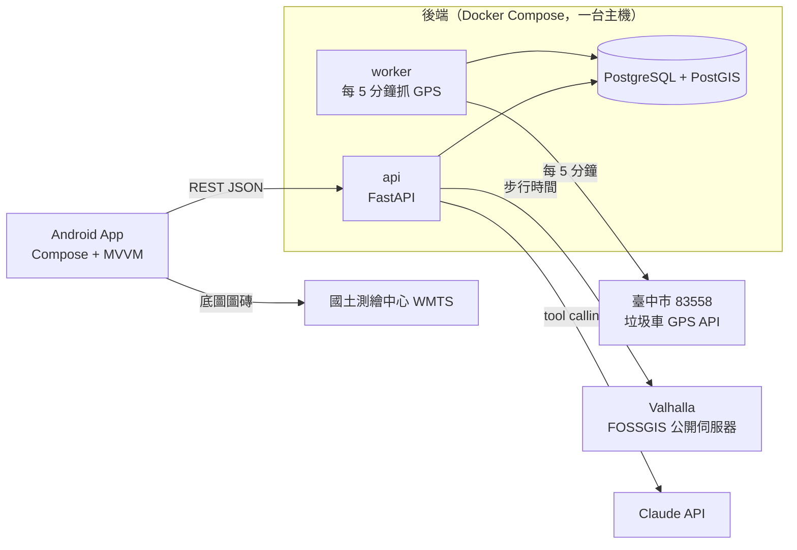
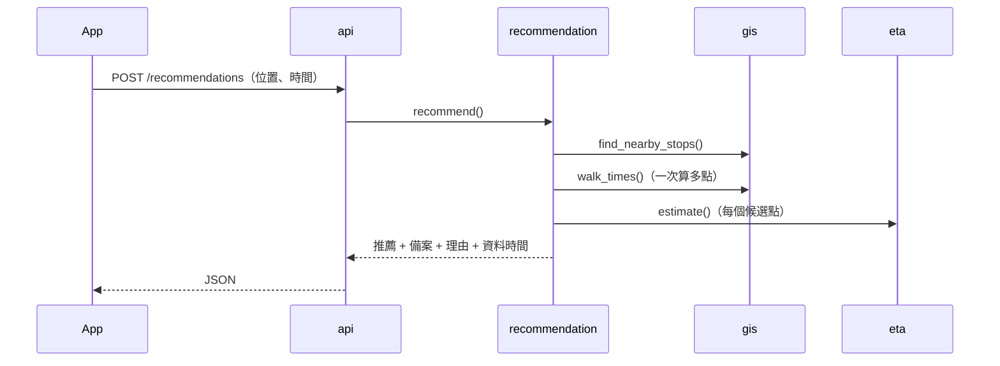

# 後端架構（v1 實作版）

> **狀態：** Approved（架構師 2026-11-22 確認；含 §9 新增套件）
> **建立日期：** 2026-11-22
> **對應：** `DESIGN.md` §3、§10；概念草稿見 `docs/architecture/modular-monolith.md`；選型見 `docs/architecture/p1-tech-selection.md`
> **用途：** 把概念架構落成「資料夾、模組介面、資料表、API」，讓 4 個人可以**同時開工、最後接得起來**。

## 一分鐘看懂

| 問題 | 答案 |
|---|---|
| 做什麼 | 使用者在 App 給位置，後端回「去哪個收運點來得及、為什麼、資料多新」 |
| 後端長怎樣 | 一份 Python 程式（FastAPI）+ 一個資料庫（PostgreSQL + PostGIS），用 Docker 包起來 |
| 放在哪 | 一位組員不關機的電腦；Cloudflare Tunnel 開一個 `https` 網址給 App 連 |
| 資料哪來 | 臺中市開放資料：收運點與時段（84004）、垃圾車 GPS（83558）；座標用門牌資料自己比對 |
| 怎麼判斷來得及 | 車最早可能幾點到 −（現在 + 走過去要多久）− 3 分鐘緩衝。大於等於 0 就來得及 |
| 最重要的規矩 | 時間、距離、座標都由程式算，LLM 不能自己編；GPS 太舊、只有表定時間，都要明講 |

**想知道誰做什麼** → `docs/plans/2026-11-22-backend-work-plan.md`。**第 1 週施工細節** → `docs/plans/2026-11-22-week1-backend-foundation.md`。

## 1. 目標與限制

**目標：** 約 4 週內做出可 Demo 的版本：使用者在 Android App 上給位置 → 後端回傳「附近哪個收運點趕得上、為什麼、資料多新」。

**限制：**

- 時間約 1 個月、4 人（前端 1、後端側 3）。
- 數字（座標、距離、步行時間、ETA）只能由程式算，LLM 不能自己編（`AGENTS.md` §9.2）。
- 不能把表定時間當成實際到達時間；過期 GPS 不能當即時位置。
- 不記錄使用者精確位置到 log（`AGENTS.md` §9.4）。

**不做（v1）：** 使用者帳號登入、推播通知、RAG、微服務拆分、多縣市。

**國定假日不支援（架構師決定 2026-11-22）：** 國定假日臺中市停止沿街收運，全部改成定時定點，班表另外公告，不在 84004 裡（`docs/proposal/02-introduction.md` [I4][I5]）。v1 不匯入假日班表。做法：

- 設定檔放一份國定假日日期清單。115 年（2026）依環保局公告：1/1、2/17、2/19、2/28、4/4、5/1、6/19、9/25、9/28、10/10、12/25（來源 [I5]，<https://cleaner.epb.taichung.gov.tw/schedule.aspx>）。
- WHEN `at` 的日期（臺北時間）在清單內 THEN `/recommendations` 回 `primary = null`、`alternatives = []`，`message` 寫「今天是國定假日，停止沿街收運，請查環保局國定假日定點班表」；`/stops/nearby` 照常回傳，但不標今天的時段。
- 2027 年以後的日期要等環保局公告再補。

**範圍（架構師決定）：** v1 只推薦**一般垃圾**。資源回收時段只顯示、不參與推薦（回收車與 84004 車牌的對應還沒驗證，見 `opendata-api-check.md` §9.4）。

## 2. 系統全貌



- **App 不直接呼叫** Valhalla、臺中市 API 或 Claude。API Key 全部留在後端 `.env`。
- **api** 和 **worker** 是同一份程式碼、兩個程序（process）。worker 只負責定時抓資料，掛掉不影響 api 查詢。

### 2.1 部署位置（架構師決定：組員一台不關機的電腦 + Cloudflare Tunnel）

| 項目 | 做法 |
|---|---|
| 主機 | 一位組員的電腦，長時間開機，跑 Docker Compose（`db`、`api`、`worker`） |
| 對外網址 | Cloudflare Tunnel 把本機 `api` 開成 `https` 網址，不用開防火牆或固定 IP。`db`、`api` 的 port 只開給本機（`127.0.0.1`），外面只能走 Tunnel |
| 網址會變嗎 | 免帳號的 Quick Tunnel 每次重啟網址都會變；要固定網址需 Cloudflare 帳號＋自己的網域（開工時確認） |
| App 怎麼連 | App 設定頁可以改「後端網址」，網址變了不用重新打包 App（前端負責） |
| 開機自動啟動 | Docker Desktop 開機自動啟動；Compose 服務設 `restart: unless-stopped`；電源設定關閉睡眠 |
| 斷線要知道 | `/health` 回最新 GPS 時間；後端 B 每天看一次，超過 30 分鐘沒新資料就處理 |
| 資料備份 | 每週把資料庫 dump 一份到別的地方（例如雲端硬碟），電腦壞掉才救得回來 |

**已知風險：** 這台電腦重開機、斷網或關機時，GPS 收集和 Demo 會一起停。對策是上面的自動啟動、每天檢查，以及第 4 週的 Demo 備援資料（用 `at` 參數＋歷史資料，不靠即時連線也能 Demo）。

### 2.2 本機開發（架構師決定 2026-11-22：每個人都能在自己電腦跑，包括資料庫）

| 項目 | 做法 |
|---|---|
| 程式 + 資料庫 | 每個人（含前端）在自己電腦跑 `docker compose up -d --build`，就有自己的 `db` 和 `api`。`api` 啟動時自動建資料表（`alembic upgrade head`） |
| 資料怎麼來 | **共用資料包** `garbagego-devdata-v1.zip`，放組內 Google Drive（連結問架構師，不寫進 repo）。下載後跑和部署主機**同一套**匯入指令 |
| 資料包內容 | `84004.json`（v1 鎖定版）、`geocode/all.csv`、`geocode/suspects.csv`、`gps/`（**1 天份**快照 + `collected_at.csv`）、`README.txt`（下載日期、sha256、GPS 是哪一天） |
| 誰做 | 後端 A 放收運點與座標（Task 4 完成後），後端 B 放 GPS（Task 5 完成後）。**第 1 週週五**前上傳 |
| 資料包更新 | 內容一改就升版號（`v2`），在群組通知。本機重建：`docker compose down -v` → `up -d --build` → 重新匯入 |
| 不用資料包的事 | 跑測試（用 `tests/` 裡的小份假資料）；第 1 週接假資料 API |
| 只在部署主機做的事 | 即時 GPS 收集、全部歷史 GPS、`d1`～`d7` 驗證、ETA 評估（1 天份 GPS 不夠） |
| 前端連本機後端 | 模擬器用 `http://10.0.2.2:8000`；實機先跑 `adb reverse tcp:8000 tcp:8000`，再連 `http://127.0.0.1:8000`。port 只開給本機也能用 |

**為什麼用資料包，不用資料庫備份檔（`pg_dump`）：** 4 週內資料表一定會改好幾次，備份檔每次都要重做；資料包只放原始檔，資料表改了重新匯入就好，也順便測到匯入程式。

> ⚠️ `docker compose down -v` 會**刪掉整個資料庫**。只在自己電腦用，**部署主機不能用**。

## 3. 資料夾結構

```text
backend/
├── app/
│   ├── main.py                 # FastAPI 入口，掛載 routers
│   ├── core/                   # 設定（讀 .env）、時間工具（Asia/Taipei）、log
│   ├── db/                     # 連線、ORM models、migrations
│   ├── api/                    # HTTP 層：只做參數驗證與組裝回應
│   │   ├── schemas.py          # ★ API 規格（Pydantic），前後端共同依據
│   │   ├── stops.py
│   │   ├── recommendations.py
│   │   ├── routes.py
│   │   └── chat.py
│   └── modules/                # 領域模組：每個模組對外只開放 service.py
│       ├── ingestion/          # 84004 匯入、座標匯入、GPS 收集 worker
│       ├── gis/                # 附近收運點、步行時間（Valhalla + 降級）
│       ├── eta/                # 到點判斷、ETA Baseline、資料新鮮度
│       ├── recommendation/     # slack 計算、排序、備案、理由
│       └── agent/              # Claude tool calling、/chat 流程
├── tests/                      # 依模組分資料夾；外部 API 一律 mock
├── Dockerfile
docker-compose.yml               # db、api、worker
.env.example                     # 只放變數名稱，不放真 Key
scripts/geocode/                 # 既有的門牌比對腳本（輸出給 ingestion 匯入）
```

**依賴方向（只能往下呼叫）：**

```text
api  →  agent  →  recommendation  →  gis, eta  →  db
                                     ingestion →  db
```

- 模組之間**只呼叫對方的 `service.py`**，不直接查對方的資料表。
- `agent` 不做任何計算，只呼叫 `recommendation`、`gis`、`eta` 的 service。

## 4. 模組介面（各模組的「合約」）

先寫好這些函式的輸入輸出，各自實作時就不會互相卡住。第 1 週先用假資料版本頂著。

| 模組 | 函式 | 輸入 | 輸出 | 負責人 |
|---|---|---|---|---|
| gis | `find_nearby_stops` | 位置、半徑（公尺）、時間 | 候選收運點清單（id、地址、座標、座標品質、今天時段、直線距離） | 後端 A |
| gis | `walk_times` | 起點、多個收運點 | 每點的步行秒數、距離、方法（`valhalla`／`fallback`） | 後端 A |
| gis | `walk_route` | 起點、終點 | 路線座標陣列（WGS84） | 後端 A |
| eta | `estimate` | 收運點 id、時間 | ETA 結果（見下） | 後端 B |
| recommendation | `recommend` | 位置、時間、可選的「最晚幾點」 | 排序後的推薦＋備案＋理由 | 架構師 |
| agent | `chat` | 使用者訊息、位置 | 文字回答＋引用的工具結果 | 架構師 |

**ETA 結果固定格式（最重要的一個合約）：**

| 欄位 | 意思 |
|---|---|
| `status` | `live`（用即時 GPS）／`schedule_only`（只有表定時間）／`stale`（GPS 太舊）／`passed`（車已經過了）／`no_data` |
| `eta` | 預計到達時間；`no_data` 時為空 |
| `eta_low`、`eta_high` | 可能範圍（不確定性） |
| `method` | 用了哪個方法，例如 `schedule`、`historical_avg`、`distance_speed` |
| `data_time` | 用到的 GPS 資料時間 |
| `scheduled_start`、`scheduled_end` | 表定時段（一定附上，但**不等於**實際到達） |

**各狀態怎麼填（架構師決定）：**

| `status` | 什麼時候 | `eta_low` / `eta` / `eta_high` |
|---|---|---|
| `live` | 負責車輛 15 分鐘內有 GPS，且後端 B 的方法算得出來 | 由後端 B 的 ETA 方法給 |
| `schedule_only` | 沒有可用 GPS，或後端 B 方法還沒好（第 1–2 週一律是這個） | `scheduled_start` / 時段中點 / `scheduled_end` |
| `stale` | 有 GPS 但超過 15 分鐘 | 同 `schedule_only`，但回應要標「GPS 過期」 |
| `passed` | `stop_arrivals` 有今天的到點紀錄；或沒有紀錄但現在已超過 `scheduled_end` | 都為空，推薦排除 |
| `no_data` | 今天沒有一般垃圾時段，或沒有座標 | 都為空，推薦排除 |

84004 只有時段、沒有收運點在路線上的順序，所以 v1 不推算順序；`passed` 只靠到點紀錄和時段結束時間。

**推薦規則（v1）：**

```text
slack = eta_low − (現在 + 步行時間) − 安全緩衝
```

- 用 `eta_low`（最早可能到）而不是 `eta`，偏保守，避免推薦「可能趕不上」的點。
- `slack ≥ 0` → 可行；排序先看可行，再看步行時間短、資料新。
- `status` 是 `stale`／`schedule_only` 的點要標「風險較高」，`passed` 的點直接排除。
- 至少回 1 個主推薦 + 最多 2 個備案；全部不可行時明說，不硬推。
- 安全緩衝預設 3 分鐘，放設定檔（架構師之後可調）。

## 5. 資料表

| 資料表 | 用途 | 重要欄位 | 負責人 |
|---|---|---|---|
| `collection_stops` | 收運點 | `id`、`area`、`village`、`caption`、`task_type`、`car_licence`、`geom`（Point, 4326）、`geocode_source`（local／tgos／manual）、`geocode_level`（exact／approx_*） | 後端 A |
| `collection_schedules` | 每週時段（把 84004 的 `d1`～`d7` 攤平） | `stop_id`、`day_index`（1–7，84004 原始值）、`kind`（general／recycle）、`start_time`、`end_time` | 後端 A |
| `vehicle_observations` | GPS 紀錄 | `car`、`observed_at`、`collected_at`、`geom`、`speed`、`source`（api／historical）、`raw`（JSONB） | 後端 A（表）／後端 B（匯入歷史） |
| `stop_arrivals` | 由 GPS 推出的「實際到點」，ETA 的歷史與評估用 | `stop_id`、`car`、`service_date`、`arrived_at`、`method` | 後端 B |

- 時間一律存 `timestamptz`，對外輸出 ISO 8601 含 `+08:00`。
- `day_index` 轉成星期幾由設定決定。**已確認 `d1`～`d7` = 星期一～日**（2026-11-24 用 GPS 驗證，見 `docs/research/opendata-api-check.md` §10.1）。這樣匯入不用等結論。
- **84004 版本鎖定（架構師決定）：** v1 只用一份 84004，下載日期和 sha256（檔案指紋）記在 `docs/research/geocoding-local-match-trial.md`。收運點的身分是「在這份檔案裡排第幾筆」（`source_index`），換版本會錯位，所以要換就整批重建。
- `vehicle_observations` 用 (`car`, `observed_at`) 去重。
- 空間查詢靠 `geom` 的 GiST 索引。
- 沒有座標的收運點（約 874 筆）照樣存，`geom` 為空，查詢時自動排除，等 TGOS 補。**不擋 Demo。**
- **座標品質（架構師決定）：** `approx_*` 的點照常推薦，但回應附 `geocode_level`，App 標「位置為近似」。試跑中離所寫里別超過 3 km 的 81 筆，先標 `geocode_level = suspect` 並排除，人工確認後再放回。

## 6. API（v0，第 1 週和前端一起定）

> 每支 API 的參數、回應欄位、範例和錯誤格式，看 `docs/architecture/api-reference.md`。

| API | 用途 | 第一版來源 | 負責人 |
|---|---|---|---|
| `GET /health` | 服務與資料狀態（最新 GPS 時間） | — | Ian1114（後端 B） |
| `GET /stops/nearby?lat=&lon=&radius=` | 附近收運點 | gis | hobartXIII（後端 A） |
| `GET /stops/{id}` | 單一收運點的每週時段 | gis | hobartXIII（後端 A） |
| `GET /stops/{id}/eta?at=` | 單一收運點今天的 ETA（格式同 §4「ETA 結果」） | eta | Ian1114（後端 B） |
| `POST /recommendations` | 推薦 | recommendation | RyanYeh57（架構師） |
| `GET /routes/walk?from_lat=&from_lon=&to_lat=&to_lon=` | 步行路線，回解碼好的座標陣列（`[lon, lat]`） | gis | hobartXIII（後端 A） |
| `POST /chat` | LLM 對話 | agent | RyanYeh57（架構師） |

- **API 分工（架構師決定 2026-11-22）：** 除了前端，3 個人各自負責幾支 API，從 HTTP 到背後的模組和測試整條做完。架構師第 1 週先把全部規格（`schemas.py`）和假資料定好；之後各自把自己那幾支換成真的。規格要改，先告訴架構師，因為前端也在用。
- `/stops/{id}/eta` 讓後端 B 的 ETA 不用等推薦做完，就能自己測、自己 Demo；前端也能在收運點詳細頁直接顯示。

- 規格寫在 `backend/app/api/schemas.py`，FastAPI 自動產生 `/docs`（OpenAPI）頁面給前端看。
- 第 1 週 API 先回**固定假資料**，前端照規格開工。
- 錯誤格式統一：`{"error": {"code": "...", "message": "..."}}`。參數不合法 → 422 `validation_error`（`message` 只寫欄位和規則，**不回傳使用者送來的值**，因為可能是位置）；找不到 → 404，例如 `stop_not_found`、`not_found`。
- `/chat` 加簡單次數限制（例如每分鐘 10 次），避免 Demo 時燒錢。
- **可指定時間（架構師決定）：** `/stops/nearby`、`/stops/{id}/eta`、`/recommendations`、`/chat` 都接受可選參數 `at`（ISO 8601；沒寫時區就當臺北時間）。沒給就用現在。API 輸出的時間一律是 `+08:00`。所有模組的函式都把「現在」當參數傳進去，**不在模組裡直接讀系統時鐘**。這樣晚上或週日也能用歷史資料 Demo，測試也好寫。

## 7. 主要流程

### 7.1 推薦



### 7.2 GPS 收集（worker）

每 5 分鐘：呼叫 83558 API（timeout 10 秒）→ 驗證欄位與座標範圍 → 去重寫入 `vehicle_observations`。失敗就記錄並等下一輪，不重試轟炸。連續 3 次失敗，`/health` 顯示資料過期。

### 7.3 降級

| 狀況 | 怎麼辦 |
|---|---|
| Valhalla 失敗或太慢（>5 秒） | 步行改用「直線距離 × 1.3 ÷ 1.2 m/s」，標 `fallback` |
| 某車 GPS 超過 15 分鐘沒更新 | ETA `status = stale`，只用表定時間＋較寬範圍 |
| 完全沒有 GPS | `schedule_only`，回答要說明「只有表定時間」 |
| Claude API 失敗 | `/chat` 回錯誤；`/recommendations` 不受影響 |

（數字 1.3、1.2 m/s、15 分鐘、5 秒都是起始值，放設定檔，後端 A、後端 B 之後依實測調整。）

## 8. 分工與 4 週里程碑

**誰是誰：** 前端 = anjyuelee、架構師 = RyanYeh57、後端 A = hobartXIII、後端 B = Ian1114。本文件其他地方寫的職稱都照這個對應。

| 週 | 前端 | 架構師 | 後端 A | 後端 B |
|---|---|---|---|---|
| **1** | App 骨架、地圖顯示底圖、照 `/docs` 接假資料；App 設定頁可改後端網址 | 骨架、Docker Compose、`schemas.py`、假資料 API | 資料表 + 匯入 84004 與座標；**在部署主機上裝好 Docker 與 Cloudflare Tunnel** | GPS 收集搬到部署主機；匯入歷史 GPS；**用歷史 GPS 確認 `d1`～`d7` 是不是星期一到日**（匯入不用等；第 2 週推薦前要有結論） |
| **2** | 附近點列表、地圖標點、推薦畫面 | `recommend` 真邏輯 + 測試；串接前端 | `find_nearby_stops`、`walk_times`（Valhalla + 降級） | 到點判斷 → `stop_arrivals`；Schedule Baseline |
| **3** | 步行路線畫線、資料時間與風險標示 | `/chat` + Claude tool calling | worker 進 Docker；`walk_route`；Tunnel 網址給前端實機測試 | 即時 ETA（歷史平均、距離／速度）+ 新鮮度 |
| **4** | 對話畫面、Demo 彩排 | 整合、文件、Demo 腳本 | Demo 備援資料、修 bug | ETA 評估（MAE、RMSE、趕上率），只寫真的跑出來的數字；只用測試段資料（`DESIGN.md` §8.1） |

**每週五**：大家把分支合進 `main`，跑一次「App → 後端 → 資料庫」整條流程。

**時間不夠時先砍：** `/chat`（App 改用按鈕）→ 進階 ETA → Valhalla（改直線粗估）。**不能砍：** 附近收運點、推薦、資料時間與風險標示。

## 9. 技術細節（我的建議，架構師確認）

| 項目 | 建議 | 為什麼 |
|---|---|---|
| 新增套件 | SQLAlchemy 2.0、GeoAlchemy2、Alembic、psycopg 3、httpx、anthropic、pytest | 都是 FastAPI + PostGIS 最常見的組合；**屬於新增依賴，確認後才裝** |
| 同步或非同步 | 先用同步（sync） | 4 週內好寫好除錯；查詢量是 Demo 等級 |
| 排程 | worker 用簡單的迴圈 + sleep | 不用另外裝排程套件（KISS） |
| 資料庫映像檔 | `postgis/postgis` 官方映像，版本開工時鎖定 | 一行啟動 |
| Claude 模型 | 寫在設定檔，開工時到官方頁面確認模型 ID 與價格 | 之後換模型只改設定 |
| 測試 | 每個模組的 service 都有單元測試；外部 API 全部 mock | `AGENTS.md` §7 |

## 10. 留給實作者決定的事

- 各模組內部怎麼拆檔案、函式命名細節。
- ORM model 的實際寫法、索引名稱。
- 假資料的內容（只要符合 `schemas.py`）。
- 「到點判斷」的半徑與停留條件（後端 B 依資料抽樣決定，寫進 `docs/research/`）。
