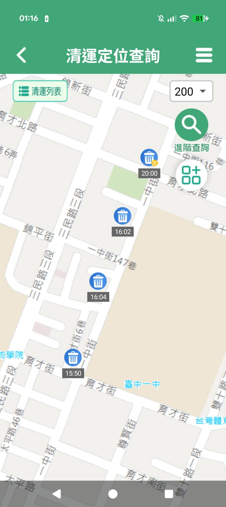
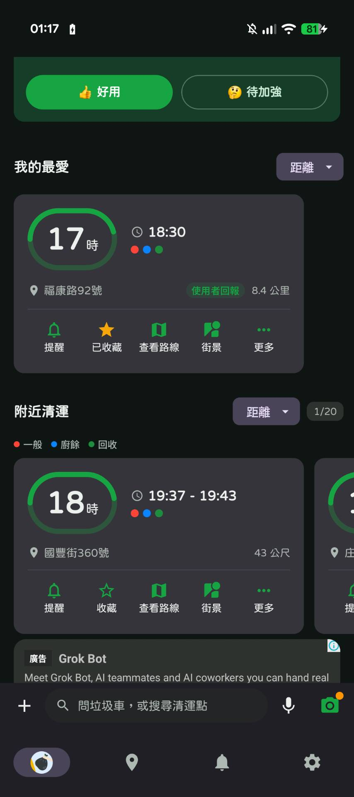
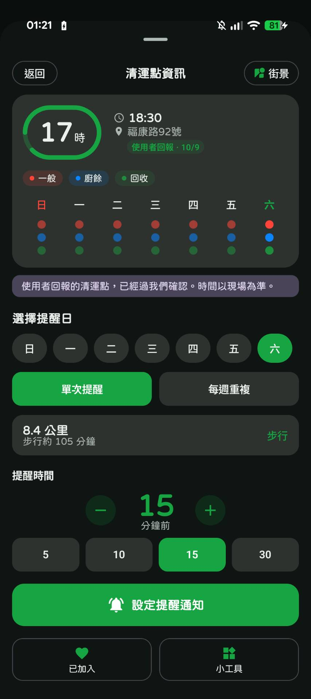
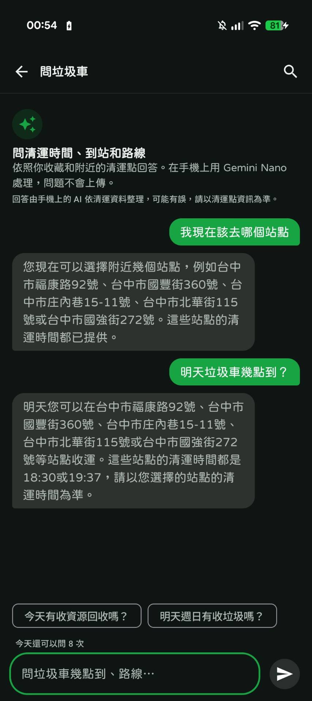
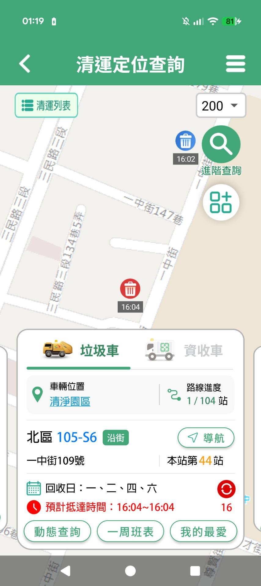

# 2. Introduction

> **負責人：** D（勇嘉）
> **Status:** Draft
> **Last Updated:** 2026-11-07

## A. Attention Getter

臺中市民每次倒垃圾前，其實都要回答一個問題：「現在去哪個收運點、走多久、幾點到，才趕得上垃圾車？」但現有服務把答案拆散在不同畫面、甚至不同 APP 裡：使用者要自己找出附近的收運點、比較各點的收運時間、估算步行時間，再另外開地圖導航。臺中市環保局的「台中垃圾清運大車隊」APP 到 2026 年 9 月已累積近 65 萬人次下載 [I1]，在 App Store 的平均評分卻只有約 2.6 顆星（609 則評分）；本組 2026-11-07 擷取的最近 100 則評論中，71 則為 1 顆星，其中超過一半（39 則）與時間不準或到站資訊錯誤有關 [I2]。Google Play 上也有類似的評論，例如「app 就突然變成已清運。車子根本沒來啊！！！」，以及「時間到了等不到垃圾車後再看結果抵達時間變成國定假日了」[I3]。

判斷錯誤的代價很高，因為市民能交垃圾的時間很短。以定時定點為例，2026 年春節初一、初三全市 701 處定時定點收運站，每處停留時間約 5 至 30 分鐘 [I4]；國定假日則停止沿街收運，當天改為定時定點服務 [I5]。錯過這段停留時間，就要等下一個收運時段，或改去其他收運點。

以 AI 整合即時資料、直接推薦據點的服務，臺中市已有先例。市府要求各局處「導入 AI 解決市政痛點、提升市民服務」[I6]；民政局 2026 年 7 月推出的戶政智慧便民服務網，讓民眾以 AI 對話輸入需求，系統即時彙整鄰近戶所的叫號進度、等待人數與交通距離，推薦 3 個適合據點，平均可節省約 5 至 10 分鐘 [I7]。然而，同樣需要「在有限時間內選對地點」的垃圾清運，目前仍停留在查詢介面；市府首屆 AI 創新應用競賽的 25 件提案中，也沒有與垃圾清運相關的應用 [I6]。

## B. Background

**應用領域：** 臺中市一般垃圾採垃圾車收運。除了平日的收運路線，市府也公告平日定點服務的位置與時間 [I8]，並在國定假日與春節期間改採定時定點收運 [I4][I5]。民眾必須在垃圾車停留期間，親自把垃圾交給垃圾車。

**使用者：** 主要使用者是需要配合收運時間倒垃圾的臺中市民。官方也指出，定點查詢功能是為了方便上班族與通勤族安排倒垃圾的時間 [I8]。

**技術背景：** 臺中市的清潔車已結合 GPS，提供即時位置與清運進度 [I8]。市府在政府資料開放平臺提供兩類相關資料：

1. **「臺中市垃圾清運及資源回收車動態資訊」[I9]**：欄位包含 `lineid`、`car`、`time`、`location`、`X`、`Y`、`SpeedValue`、`OverSpeed`，資料集頁面標示的更新頻率為「每10分」。
2. **「臺中市定時定點垃圾收運地點」[I10]**：欄位包含行政區、里別、車牌、清運地址、清運方式與時間，更新頻率為「不定期更新」。

兩者都採用「政府資料開放授權條款－第1版」[I9][I10]，可作為本專題的資料基礎。

## C. Problem

本專題要解決的問題是：

> **使用者現在應該前往哪一個收運點，才最可能趕上垃圾車？**

這不只是查詢「垃圾車在哪裡」或「垃圾車幾點到」，而是一個決策問題。使用者附近通常有多個候選收運點，每個點的垃圾車抵達時間、停留時間與步行距離都不同。對每個候選點，要同時考慮：

- 垃圾車還要多久才會抵達（truck ETA）。
- 使用者走過去要多久（walking time）。
- 資料延遲、預測誤差與步行差異所需的緩衝時間（safety buffer）。

只有在「垃圾車到點時間 − 步行時間 − 緩衝時間」仍有餘裕時，前往該點才可行。如果最近的點趕不上，系統還要能找出其他可行的點。

## D. Existing Limitations

本節比較兩個現有服務：臺中市環保局的官方 APP「臺中垃圾清運大車隊」[I2]，以及民間開發、在 App Store 有近萬則評分的「垃圾車App」[I11]。依官方公開說明、App Store 說明與本組實際使用（2026-11-07），現有服務仍有以下限制：

1. **只能查詢單一點，或依距離列出附近的點，無法判斷哪個點來得及。**
   - **官方 APP** 讓使用者查看指定路線、車輛或清運點的收運進度與預計抵達時間 [I1][I8]。附近清運點只能用固定範圍篩選，預設 100／200／300 公尺，也可手動輸入 50–999 公尺；地圖上只標示各點的表定時間，不顯示距離，也不估算步行時間（圖 1）。推播提醒只能設定在清運前 3 分鐘或 5 分鐘 [I4]。
   - **民間 APP** 會顯示到各點的距離與步行時間，但附近清運點只依距離排序，沒有依「哪個點來得及」比較（圖 2）。提醒時間由使用者固定選擇 5–30 分鐘前，不會隨步行時間調整；圖 3 中，步行約需 105 分鐘的清運點，提醒仍設在 15 分鐘前。由畫面上「8.4 公里、步行約 105 分鐘」換算，步行速度約為每秒 1.33 公尺，畫面中也沒有調整步速的選項。但長者、孩童與一般成人的步速並不相同，用單一速度估算，可能高估行動較慢者趕上的可能性。
   - 民間 APP 的「問 AI」功能，被問到「我現在該去哪個站點」時，只列出附近幾個站點的地址；問到幾點到時，只回覆表定時間，沒有根據垃圾車的即時位置判斷是否來得及（圖 4）。

   

   **圖 1** 官方 APP 的清運定位查詢。右上角為搜尋範圍（200 公尺），地圖上各清運點只標示表定時間，不顯示距離。（本組實際使用截圖，2026-11-07）

   

   **圖 2** 民間 APP 首頁。「附近清運」依距離排序，排序依據不包含垃圾車何時抵達。（本組實際使用截圖，2026-11-07）

   

   **圖 3** 民間 APP 的清運點資訊。顯示步行時間，但提醒時間為固定的分鐘數，與步行時間無關。（本組實際使用截圖，2026-11-07）

   

   **圖 4** 民間 APP 的「問垃圾車」。詢問「我現在該去哪個站點」時，只列出附近站點地址。（本組實際使用截圖，2026-11-07）

2. **即時資料存在更新延遲。** 臺中市清潔車的 GPS 車機每 20 秒回傳一次定位，官方系統也依此計算各清運點的預估抵達時間 [I12]；但開放資料平臺上的垃圾車動態資料，標示的更新頻率為每 10 分鐘 [I9]。本組實測 29 天的結果顯示，API 約每 5 分鐘產生一次快照，每次只提供各車最新的一筆位置，不提供歷史軌跡（見 `docs/research/opendata-api-check.md`）。因此第三方服務看到的位置，可能已經是幾分鐘前的資料，比官方系統內部使用的粗得多。相較之下，春節期間的定時定點每處停留時間約 5 至 30 分鐘 [I4]，幾分鐘的延遲就足以影響「現在出發是否來得及」的判斷。

3. **預定時間不等於實際抵達時間。** 定時定點資料提供的是公告的收運時間，而且資料為不定期更新 [I10]。垃圾車實際抵達的時間可能和表定時間不同，而且前段的延誤會傳到後面各點：臺中市環保局的系統即假設某點晚到幾分鐘，之後各點也會晚到相同分鐘數 [I12]。使用者也反映過這種落差，例如 Google Play 上的評論寫道「時間到了等不到垃圾車」[I3]。單靠公告時間無法判斷當下是否來得及。依本組實際使用，官方 APP 顯示的預計抵達時間大多與表定時間相同（圖 5）。使用者對預估準確度的不滿也反映在評價上：官方 APP 在 App Store 的平均評分約 2.6 顆星（609 則評分）；本組 2026-11-07 擷取的最近 100 則評論中，71 則為 1 顆星，其中 39 則與時間不準或到站資訊錯誤有關 [I2]。民間 APP 的最近 100 則評論中，也有 73 則為 1 顆星，其中 37 則同樣與時間有關 [I11]；Google Play 上也有使用者批評它「只是垃圾車預計時間表而已」[I13]。統計方法、評論原文與 Google Play 評論截圖見 `docs/research/app-review-snapshot-2026-11-07.md`。

   

   **圖 5** 官方 APP 的清運點卡片，顯示路線進度、本站站序與預計抵達時間。截圖時間為凌晨，車輛尚未出勤，因此本圖只能說明介面呈現方式，不能證明收運時段的預估也是固定班表。（本組實際使用截圖，2026-11-07）

4. **缺少不確定性提示與備案。** 依官方公開說明與本組實際使用，兩個 APP 都只提供單一的預計時間，不顯示預估可能的誤差或風險；使用者趕不上某個點時，兩個 APP 也都不會主動建議其他收運點或下一個時段，需要使用者自己查詢。

## E. Innovation

GarbageGo 與既有服務的主要差異：

1. **從「查詢」轉為「決策」。** 既有服務回答「垃圾車何時到某個點」，或依距離列出附近的點；GarbageGo 回答「我現在應該去哪個點」，比較使用者附近多個候選點的時間可行性。
2. **以時間可行性排序，而不是距離。** 顯示步行時間已有服務做到 [I11]，GarbageGo 的差異在於把步行時間與垃圾車 ETA、緩衝時間合併計算：對每個候選點計算時間餘裕 `slack = truck_ETA − walking_time − safety_buffer`，再依可行性排序，而不是依距離。步行時間依路網估計，步行速度採保守預設值並可由使用者調整，避免高估行動較慢者趕上的可能性。
3. **把資料新鮮度與不確定性納入判斷。** 標示資料更新時間已有服務做到；GarbageGo 進一步區分預定時間、估計時間與實際觀測時間，並依資料新鮮度與剩餘站數調整緩衝時間，轉換成「可行／有風險／不建議」等可行性等級。資料不足時直接告知使用者，不提供沒有依據的精確時間。
4. **Domain AI Agent 架構。** 既有服務的 AI 問答只列出附近站點與表定時間（圖 4）。GarbageGo 的 LLM Agent 負責理解自然語言需求，調用 GIS Engine、ETA Engine 與 Recommendation Engine，再根據這些工具的計算結果，以繁體中文說明推薦理由。LLM 不自行推測 GPS、ETA 或距離。
5. **自動提供備案。** 既有服務在使用者趕不上時不會主動建議替代方案。GarbageGo 在最佳候選點不可行時，會搜尋其他收運點或下一個時段；確實沒有可行方案時，會明確告知，不製造推薦。

## F. Contributions

本專題預期的主要貢獻如下（Proposal 階段，皆為 Expected Contributions）：

1. **問題定義：** 把「趕垃圾車」定義成結合 ETA、步行時間與不確定性的到點可行性推薦問題。
2. **系統設計：** 提出整合 LLM Agent、GIS Engine、ETA Engine、Recommendation Engine 與 Domain Knowledge 的 Domain AI Agent 架構，各模組職責明確，數值計算不交由 LLM 猜測。
3. **推薦方法：** 提出以時間餘裕、資料新鮮度與預測不確定性為依據的候選點可行性評估與排序方法，並在不可行時提供備案。
4. **資料可行性分析：** 盤點臺中市垃圾車動態與定時定點開放資料的欄位、更新頻率與限制，作為後續研究與實作的基礎。
5. **評估框架：** 預計比較「最近點策略」與「時間可行性策略」的推薦結果，並以 Schedule Baseline 等方法作為 ETA 的比較基準；評估指標包含 ETA 的 MAE／RMSE 與推薦的趕上率等。實際結果將在完成資料蒐集與實驗後才會填入。

## References

> 存取日期：2026-11-06 至 2026-11-07。本章以 [I] 編號；`04-deep-research.md` 以 [D] 編號，兩章部分來源相同但各自編號。圖 1–5 為本組實際使用截圖，存放於 `figures/app-taichung-official/` 與 `figures/app-garbagetruck/`。

- [I1] 臺中市政府環境保護局，〈台中「垃圾清運大車隊」服務再升級！ APP動態查詢更直覺　網站同步推動無障礙優化〉，臺中市政府全球資訊網市政新聞，2026-09-29。<https://www.taichung.gov.tw/8868/8872/9962/3379879>
- [I2] Taichung City Government，「臺中垃圾清運大車隊」，App Store（臺灣），iOS 版本 2.63（2026-10-12）。評分與評論於 2026-11-07 經 iTunes Search API 與評論 RSS 擷取，擷取方法、統計與評論原文保存於 `docs/research/app-review-snapshot-2026-11-07.md`；本組實際使用 Android 版 2.99。<https://apps.apple.com/tw/app/id935569593>
- [I3] 臺中市政府，「臺中垃圾清運大車隊」，Google Play。評分（擷取當下顯示 2.8 顆星）與引用評論為本組 2026-11-07 截圖，見 `docs/research/app-review-snapshot-2026-11-07.md` 圖 A。<https://play.google.com/store/apps/details?id=tw.gis.tgcar>
- [I4] 臺中市政府環境保護局，〈115年春節垃圾收運安排出爐　初一、初三採定時定點　初四恢復正常清運〉，2026-01-26。<https://www.epb.taichung.gov.tw/3198939/post>
- [I5] 臺中市政府環境保護局，「國定假日定點班表」，臺中垃圾清運大車隊即時查詢系統。頁面載明 115 年 1 月 1 日、2 月 17 日、2 月 19 日、2 月 28 日、4 月 4 日、5 月 1 日、6 月 19 日、9 月 25 日、9 月 28 日、10 月 10 日、12 月 25 日「停止沿街垃圾收運，當天改為定時定點服務」。<https://cleaner.epb.taichung.gov.tw/schedule.aspx>
- [I6] 臺中市政府數位發展局，〈中市府首屆「AI創新應用競賽」結果出爐！展現智慧台中、AI便民新動能〉，臺中市政府全球資訊網市政新聞，2025-12-04。<https://www.taichung.gov.tw/8868/8872/9962/3158509>
- [I7] 臺中市政府民政局，〈全國首創！ 中市府戶政智慧便民服務網上線　一鍵規劃最省時洽公路線〉，臺中市政府全球資訊網市政新聞，2026-07-10。<https://www.taichung.gov.tw/3318659/post>
- [I8] 臺中市政府環境保護局，〈查詢更便利！「台中垃圾清運大車隊」APP全新改版 介面升級、操作更流暢〉，2025-11-24。<https://cleaner.epb.taichung.gov.tw/newsmain.aspx?n_id=20527>
- [I9] 臺中市政府環境保護局，「臺中市垃圾清運及資源回收車動態資訊」，政府資料開放平臺。<https://data.gov.tw/dataset/83558>
- [I10] 臺中市政府環境保護局，「臺中市定時定點垃圾收運地點」，政府資料開放平臺。<https://data.gov.tw/dataset/84004>
- [I11] CHEN GUAN-JHEN，「垃圾車App - 今天幾點到 台灣清運點即時動態查詢 追蹤」，App Store（臺灣），版本 5.10.0（2026-10-22）。評分與評論於 2026-11-07 擷取，統計保存於 `docs/research/app-review-snapshot-2026-11-07.md`。<https://apps.apple.com/tw/app/id1527915502>
- [I12] 臺中市政府環境保護局，《111 年度清潔車即時衛星定位便民查詢及管理系統計畫 結案報告定稿》，2022。引用頁碼依報告內頁碼：GPS 車機規格見頁 2–3、13；預估到點時間要求見頁 4；「前後點延遲推估演算法」與早退偵測見頁 18–20。<https://www.epb.taichung.gov.tw/media/899636/111%E5%B9%B4_%E6%B8%85%E6%BD%94%E8%BB%8A%E5%8D%B3%E6%99%82%E8%A1%9B%E6%98%9F%E5%AE%9A%E4%BD%8D%E4%BE%BF%E6%B0%91%E6%9F%A5%E8%A9%A2%E5%8F%8A%E7%AE%A1%E7%90%86%E7%B3%BB%E7%B5%B1%E8%A8%88%E7%95%AB%E6%9C%9F%E6%9C%AB%E5%A0%B1%E5%91%8A_%E6%B8%85%E6%BD%94%E7%A7%91.pdf>
- [I13] Ai Joy Apps，「垃圾車 App - 今天有垃圾車嗎 時間查詢 即時動態」，Google Play。引用評論為本組 2026-11-07 截圖，見 `docs/research/app-review-snapshot-2026-11-07.md` 圖 B。<https://play.google.com/store/apps/details?id=tw.garbagetruck.app>
