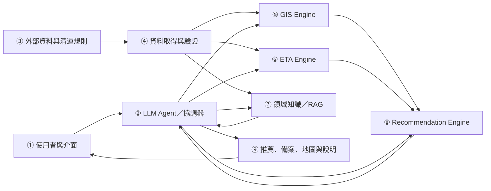
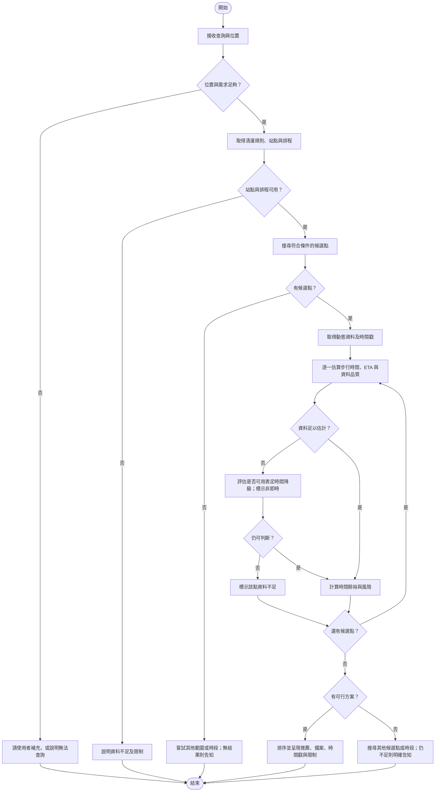

# 5. Proposed Scheme：垃圾收運點到點可行性推薦

> **狀態：** Proposal 草稿；以下為規劃中的系統與評估方法，尚未實作或驗證。架構依 `DESIGN.md` 整理，正式技術選型與實作範圍仍待確認。

## 5.1 問題與目標

GarbageGo 希望回答：「使用者現在應該前往哪個收運點，才有機會趕上垃圾車？」系統預計結合臺中市清運點與車輛動態資料、步行路網和清運規則，估計多個候選點的時間可行性，提供推薦、備案、資料時間及限制。

設計重點是將**垃圾車預估到達時間**與**使用者步行時間**放在一起比較，並考量資料延遲與預測不確定性。LLM Agent 負責理解問題、協調工具與解釋結果；位置、路徑、ETA 和排序由相應資料與工具提供，不由 LLM 自行猜測。

## 5.2 System Architecture



| 編號 | 元件 | 責任與邊界 |
|---|---|---|
| ① | 使用者與介面 | 接收自然語言需求與經授權的位置，呈現地圖和說明。 |
| ② | LLM Agent／協調器 | 辨識需求、選擇並調用工具，根據工具結果組織回答；不自行生成未經工具支持的數值。 |
| ③ | 外部資料與清運規則 | 提供車輛動態、收運點與時段、路網、官方公告；需保留來源及有效時間。 |
| ④ | 資料取得與驗證 | 取得、標準化並檢查時間、座標與車輛資料；記錄來源、觀測時間與取得時間。 |
| ⑤ | GIS Engine | 搜尋候選收運點，利用步行路網估計使用者到各點的時間；地圖服務尚未選定。 |
| ⑥ | ETA Engine | 根據可用排程、動態或歷史資料估計垃圾車到點時間，並提供資料時間與可能的誤差資訊。 |
| ⑦ | 領域知識／RAG | 提供收運類別、時段與公告等規則；RAG 是否導入待確認，不取代 ETA 或路徑計算。 |
| ⑧ | Recommendation Engine | 排除不符合條件或已明確錯過的點，依時間餘裕、風險和步行負擔評估，搜尋備案。 |
| ⑨ | 結果與互動 | 顯示推薦點、估計依據、資料時間、限制與替代方案；資料不足時明確告知。 |

目前的部署方向是**模組化單體架構**與 **PostgreSQL/PostGIS**，用一個後端承載不同模組並支援空間查詢；這仍是待核准的設計方向，不表示技術選型或功能已完成。

## 5.3 Flowchart



降級使用排程時，系統必須標示「表定時間」，不可稱為即時 ETA 或保證趕得上。若排程、站點對應或步行時間不足以支持判斷，應回報資料不足，不強行推薦。

## 5.4 核心演算法

對每個候選收運點 `s`，以同一查詢時間為基準，單位統一為分鐘：

```text
slack(s) = truck_ETA(s) - walking_time(s) - safety_buffer(s)
```

- `truck_ETA`：距垃圾車預估到點的剩餘時間；以排程降級時需明確標示。
- `walking_time`：使用者依步行路網到達候選點的估計時間。
- `safety_buffer`：為資料延遲、預測誤差與步行差異保留的時間；實際設定待驗證。
- `slack`：扣除緩衝後的時間餘裕；大於零只代表初步可能可行，**不保證能趕上**。

```text
Algorithm 1: 收運點時間可行性推薦（概念草稿）
Input: 使用者需求 Q、授權位置 L、查詢時間 T
Output: 推薦、備案、依據與限制，或資料不足的說明

01  intent <- 解析 Q 並確認 L 與必要條件
02  IF 必要條件不足: RETURN 請求補充或無法查詢
03  data <- 取得並驗證收運規則、站點、排程與資料時間
04  IF 必要站點或排程不可用: RETURN 資料不足及限制
05  stops <- 搜尋符合條件的候選收運點
06  IF stops 為空: RETURN 搜尋其他範圍或時段的結果，或無候選點
07  live <- 取得車輛動態資料與觀測時間；失敗時記錄原因
08  FOR EACH stop IN stops:
09      IF 明確不符合清運條件或已錯過: 排除 stop; CONTINUE
10      walk <- 估計 L 至 stop 的步行時間
11      eta <- 依可用資料估計車輛到 stop 的剩餘時間
12      quality <- 評估資料新鮮度、來源與不確定性
13      IF 動態資料過期或缺失: 嘗試以排程降級並標示表定時間
14      IF 步行時間、時間依據或站點對應不足:
15          標示 stop 不確定及原因; CONTINUE
16      buffer <- 依資料品質與不確定性設定緩衝時間
17      slack <- eta.remaining_minutes - walk.minutes - buffer
18      評估 stop 可行性、步行負擔、風險與說明依據
19  依時間餘裕、風險與步行負擔排序可行候選點
20  IF 無可行候選點: 搜尋其他範圍或時段，或回報無法確認
21  RETURN 推薦、備案、資料來源與時間戳、不確定性及限制
```

排序權重、資料過期門檻及緩衝時間尚未定案；須以資料與測試驗證。排程降級的結果是保守參考，與使用可用動態資料估算的結果應明確區分。

## 5.5 資料與技術可行性

| 項目 | 已有資訊與限制 | 後續工作 |
|---|---|---|
| 車輛動態 | 政府資料開放平臺標示每 10 分鐘更新；本組有限觀察推定約每 5 分鐘產生快照，並非保證。API 回應只含各車最新位置。 | 持續驗證更新頻率、可用性與過期判斷；區分車輛回報時間與資料取得時間。 |
| 收運點與車輛 | 本組收運點資料的 374 個車牌中，358 個曾出現在 29 天動態資料；收運點地址沒有座標。 | 檢查車牌對應時效與路線關係，評估地址轉座標的準確度。 |
| 歷史資料 | 本組記錄約 29 天、98 萬筆去重 GPS 點，原始資料保存在本機；觀測有缺漏。 | 確認保存與使用條件、代表性，以及能否推定可靠的實際到點時間。 |
| 步行時間 | 需要臺中可用的步行路網與路徑服務，目前供應商未定。 | 比較涵蓋率、費用、配額與條款，並驗證估計誤差。 |
| 領域規則 | 清運時段、垃圾種類與假日公告會影響候選點。 | 確認資料來源、適用日期及更新方式，避免使用過期規則。 |

實測期間、抽樣條件與限制詳見 [OpenData API 實測](../research/opendata-api-check.md)。資料足以支持初步可行性探討，不代表已足以可靠預測每個站點或完成模型評估。

## 5.6 預計評估

| 評估項目 | 預計方法 | 前提與限制 |
|---|---|---|
| ETA | 比較 Schedule Baseline 與資料允許的 Distance/Speed、Historical Baseline，使用 MAE、RMSE 與誤差分布。 | 須先取得或可靠推定實際到點時間；無法確認時不可宣稱精度。 |
| 推薦 | 比較最近點與時間可行性策略的趕上率、誤判率與備案有效率。 | 須先定義實際可趕上的判定方式，並取得對應觀測或可信資料。 |
| GIS 與步行 | 比較估計步行時間與實際或可信參考資料。 | 路網、使用者速度與測試範圍需記錄。 |
| 穩定性與 Agent | 使用資料過期、API 失敗、無候選點等情境，檢查降級、工具調用及回答是否可追溯。 | 測試案例與驗收標準需先訂定；模擬結果不代表真實服務可用性。 |

使用歷史資料時，應依時間區分訓練、驗證與測試資料，避免資料洩漏。上述均為評估計畫，尚無 GarbageGo 的實驗結果。
