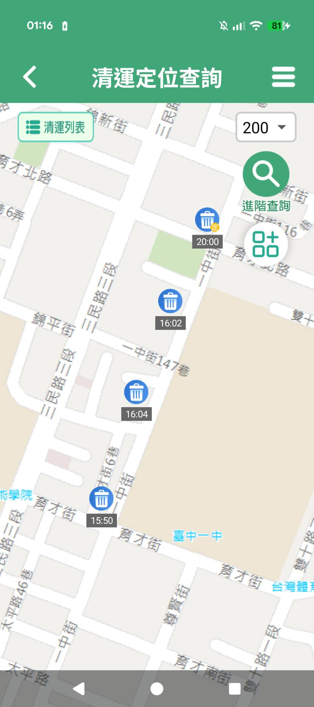
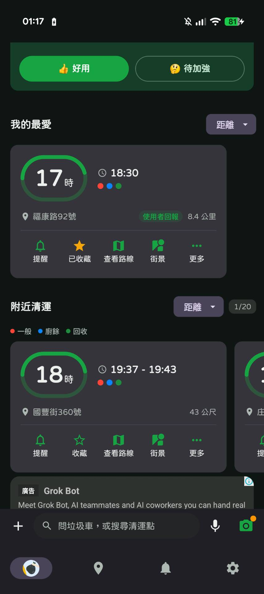
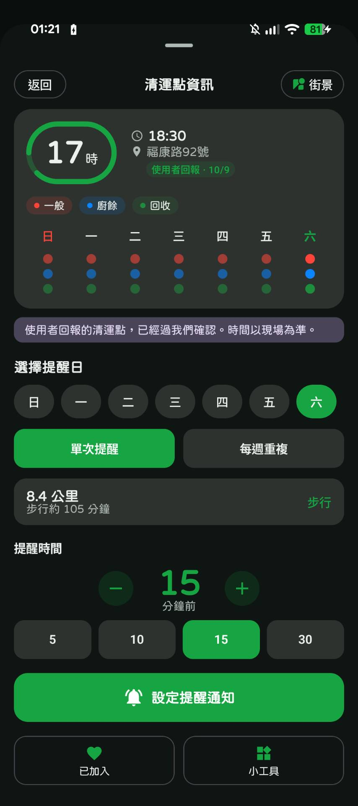
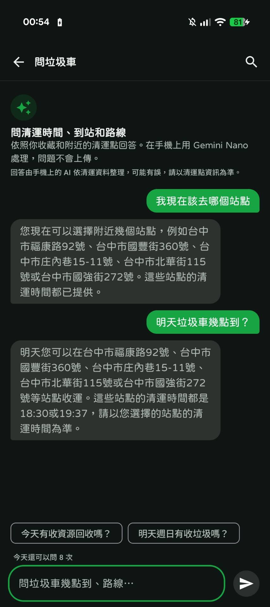
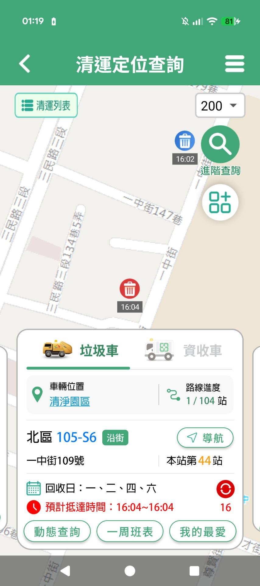
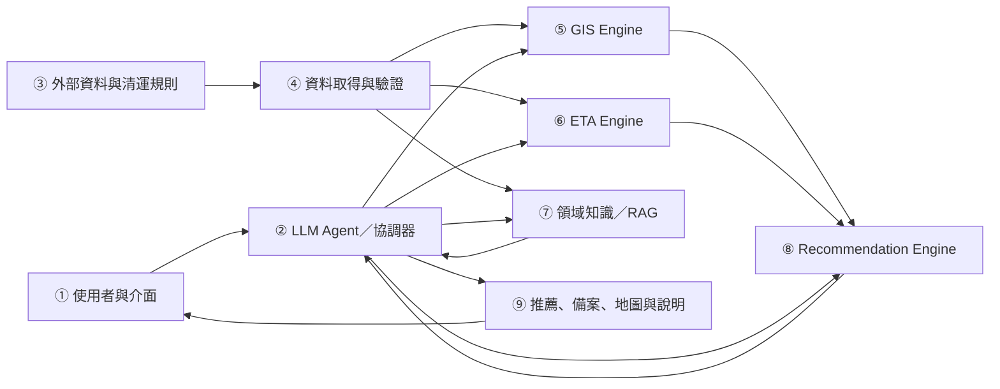
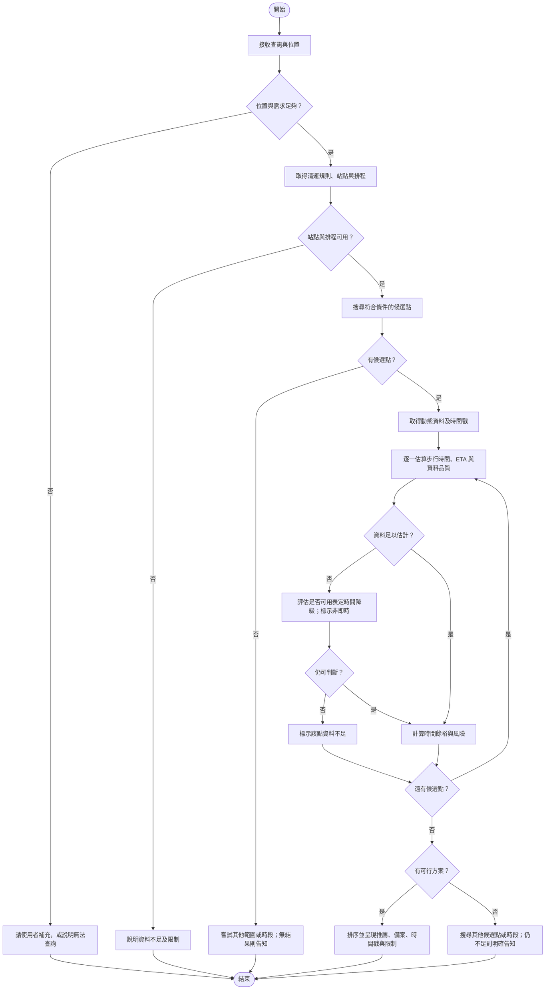

# GarbageGo Proposal

> 整合草稿：內容和設計仍待確認；未完成實驗的敘述均為規劃或預期結果。

# 1. Abstract

> **狀態：** Proposal 草稿；下列系統與評估方法皆為規劃，非已完成的實驗結果。

**A. Attention Getter — Motivation：** 臺中市民倒垃圾時，需要配合垃圾車的清運時間前往收運點。臺中市環保局指出，「台中垃圾清運大車隊」App 截至 2026 年 9 月已累積近 65 萬人次下載 [1]，顯示民眾有查詢清運資訊的需求。然而，知道垃圾車的位置或表定時間後，居民仍需考慮自己走到收運點要多久，才能判斷是否來得及。

**B. But — Challenge：** 本組檢視的服務與研究中，尚未找到同時結合垃圾車預估到點時間、居民步行時間與資料不確定性，直接比較多個收運點是否可行的完整方案。此外，公開資料可能存在更新延遲，收運點地址也需轉換為座標，車輛與站點的關聯仍須確認 [2][3]。

**C. Cure — Proposed Solution：** 為協助居民選擇收運點，本專題提出 GarbageGo，一個以臺中市垃圾清運為情境的 Domain AI Agent（領域智慧代理人）。系統規劃根據使用者位置與需求，比較附近收運點，推薦可能趕上的選擇，並在必要時提供備案。

**D. Development — Method：** 系統規劃整合官方車輛動態資料、收運點資料、步行路網與清運規則。GIS Engine 估計使用者的步行時間，ETA Engine 估計垃圾車抵達各點的剩餘時間，Recommendation Engine 再依時間餘裕、資料新鮮度與風險評估候選點。LLM Agent 負責理解需求、協調工具及說明結果；資料不足時，系統將標示限制，並區分表定時間與預估到點時間。

**E. Experiments — Evaluation：** 預計以可取得的臺中資料建立排程、距離／速度及歷史統計等可行的 ETA 基準，並在取得可信的實際到點時間後，以 MAE、RMSE 衡量預測誤差。推薦部分規劃比較「最近點」與「時間可行性」策略的趕上率及誤判率；實際到點時間的取得方式與資料適用性仍須驗證。

**F. Findings — Expected Outcomes：** 本專題預期提供附有推薦依據、資料時間與風險說明的收運點建議，並釐清公開資料的更新間隔與缺漏對到點估計的影響。目前系統與比較實驗尚未完成，實際預測準確度及推薦成效須待驗證。

# 2. Introduction

> **負責人：** D（勇嘉）
> **Status:** Draft
> **Last Updated:** 2026-11-07

## A. Attention Getter

臺中市民每次倒垃圾前，其實都要回答一個問題：「現在去哪個收運點、走多久、幾點到，才趕得上垃圾車？」但現有服務把答案拆散在不同畫面、甚至不同 APP 裡：使用者要自己找出附近的收運點、比較各點的收運時間、估算步行時間，再另外開地圖導航。臺中市環保局的「台中垃圾清運大車隊」APP 到 2026 年 9 月已累積近 65 萬人次下載 [1]，在 App Store 的平均評分卻只有約 2.6 顆星（609 則評分）；本組 2026-11-07 擷取的最近 100 則評論中，71 則為 1 顆星，其中超過一半（39 則）與時間不準或到站資訊錯誤有關 [4]。Google Play 上也有類似的評論，例如「app 就突然變成已清運。車子根本沒來啊！！！」，以及「時間到了等不到垃圾車後再看結果抵達時間變成國定假日了」[5]。

判斷錯誤的代價很高，因為市民能交垃圾的時間很短。以定時定點為例，2026 年春節初一、初三全市 701 處定時定點收運站，每處停留時間約 5 至 30 分鐘 [6]；國定假日則停止沿街收運，當天改為定時定點服務 [7]。錯過這段停留時間，就要等下一個收運時段，或改去其他收運點。

以 AI 整合即時資料、直接推薦據點的服務，臺中市已有先例。市府要求各局處「導入 AI 解決市政痛點、提升市民服務」[8]；民政局 2026 年 7 月推出的戶政智慧便民服務網，讓民眾以 AI 對話輸入需求，系統即時彙整鄰近戶所的叫號進度、等待人數與交通距離，推薦 3 個適合據點，平均可節省約 5 至 10 分鐘 [9]。然而，同樣需要「在有限時間內選對地點」的垃圾清運，目前仍停留在查詢介面；市府首屆 AI 創新應用競賽的 25 件提案中，也沒有與垃圾清運相關的應用 [8]。

## B. Background

**應用領域：** 臺中市一般垃圾採垃圾車收運。除了平日的收運路線，市府也公告平日定點服務的位置與時間 [10]，並在國定假日與春節期間改採定時定點收運 [6][7]。民眾必須在垃圾車停留期間，親自把垃圾交給垃圾車。

**使用者：** 主要使用者是需要配合收運時間倒垃圾的臺中市民。官方也指出，定點查詢功能是為了方便上班族與通勤族安排倒垃圾的時間 [10]。

**技術背景：** 臺中市的清潔車已結合 GPS，提供即時位置與清運進度 [10]。市府在政府資料開放平臺提供兩類相關資料：

1. **「臺中市垃圾清運及資源回收車動態資訊」[2]**：欄位包含 `lineid`、`car`、`time`、`location`、`X`、`Y`、`SpeedValue`、`OverSpeed`，資料集頁面標示的更新頻率為「每10分」。
2. **「臺中市定時定點垃圾收運地點」[3]**：欄位包含行政區、里別、車牌、清運地址、清運方式與時間，更新頻率為「不定期更新」。

兩者都採用「政府資料開放授權條款－第1版」[2][3]，可作為本專題的資料基礎。

## C. Problem

本專題要解決的問題是：

> **使用者現在應該前往哪一個收運點，才最可能趕上垃圾車？**

這不只是查詢「垃圾車在哪裡」或「垃圾車幾點到」，而是一個決策問題。使用者附近通常有多個候選收運點，每個點的垃圾車抵達時間、停留時間與步行距離都不同。對每個候選點，要同時考慮：

- 垃圾車還要多久才會抵達（truck ETA）。
- 使用者走過去要多久（walking time）。
- 資料延遲、預測誤差與步行差異所需的緩衝時間（safety buffer）。

只有在「垃圾車到點時間 − 步行時間 − 緩衝時間」仍有餘裕時，前往該點才可行。如果最近的點趕不上，系統還要能找出其他可行的點。

## D. Existing Limitations

本節比較兩個現有服務：臺中市環保局的官方 APP「臺中垃圾清運大車隊」[4]，以及民間開發、在 App Store 有近萬則評分的「垃圾車App」[11]。依官方公開說明、App Store 說明與本組實際使用（2026-11-07），現有服務仍有以下限制：

1. **只能查詢單一點，或依距離列出附近的點，無法判斷哪個點來得及。**
   - **官方 APP** 讓使用者查看指定路線、車輛或清運點的收運進度與預計抵達時間 [1][10]。附近清運點只能用固定範圍篩選，預設 100／200／300 公尺，也可手動輸入 50–999 公尺；地圖上只標示各點的表定時間，不顯示距離，也不估算步行時間（圖 1）。推播提醒只能設定在清運前 3 分鐘或 5 分鐘 [6]。
   - **民間 APP** 會顯示到各點的距離與步行時間，但附近清運點只依距離排序，沒有依「哪個點來得及」比較（圖 2）。提醒時間由使用者固定選擇 5–30 分鐘前，不會隨步行時間調整；圖 3 中，步行約需 105 分鐘的清運點，提醒仍設在 15 分鐘前。由畫面上「8.4 公里、步行約 105 分鐘」換算，步行速度約為每秒 1.33 公尺，畫面中也沒有調整步速的選項。但長者、孩童與一般成人的步速並不相同，用單一速度估算，可能高估行動較慢者趕上的可能性。
   - 民間 APP 的「問 AI」功能，被問到「我現在該去哪個站點」時，只列出附近幾個站點的地址；問到幾點到時，只回覆表定時間，沒有根據垃圾車的即時位置判斷是否來得及（圖 4）。

   

   **圖 1** 官方 APP 的清運定位查詢。右上角為搜尋範圍（200 公尺），地圖上各清運點只標示表定時間，不顯示距離。（本組實際使用截圖，2026-11-07）

   

   **圖 2** 民間 APP 首頁。「附近清運」依距離排序，排序依據不包含垃圾車何時抵達。（本組實際使用截圖，2026-11-07）

   

   **圖 3** 民間 APP 的清運點資訊。顯示步行時間，但提醒時間為固定的分鐘數，與步行時間無關。（本組實際使用截圖，2026-11-07）

   

   **圖 4** 民間 APP 的「問垃圾車」。詢問「我現在該去哪個站點」時，只列出附近站點地址。（本組實際使用截圖，2026-11-07）

2. **即時資料存在更新延遲。** 臺中市清潔車的 GPS 車機每 20 秒回傳一次定位，官方系統也依此計算各清運點的預估抵達時間 [12]；但開放資料平臺上的垃圾車動態資料，標示的更新頻率為每 10 分鐘 [2]。本組實測 29 天的結果顯示，API 約每 5 分鐘產生一次快照，每次只提供各車最新的一筆位置，不提供歷史軌跡（見 `docs/research/opendata-api-check.md`）。因此第三方服務看到的位置，可能已經是幾分鐘前的資料，比官方系統內部使用的粗得多。相較之下，春節期間的定時定點每處停留時間約 5 至 30 分鐘 [6]，幾分鐘的延遲就足以影響「現在出發是否來得及」的判斷。

3. **預定時間不等於實際抵達時間。** 定時定點資料提供的是公告的收運時間，而且資料為不定期更新 [3]。垃圾車實際抵達的時間可能和表定時間不同，而且前段的延誤會傳到後面各點：臺中市環保局的系統即假設某點晚到幾分鐘，之後各點也會晚到相同分鐘數 [12]。使用者也反映過這種落差，例如 Google Play 上的評論寫道「時間到了等不到垃圾車」[5]。單靠公告時間無法判斷當下是否來得及。依本組實際使用，官方 APP 顯示的預計抵達時間大多與表定時間相同（圖 5）。使用者對預估準確度的不滿也反映在評價上：官方 APP 在 App Store 的平均評分約 2.6 顆星（609 則評分）；本組 2026-11-07 擷取的最近 100 則評論中，71 則為 1 顆星，其中 39 則與時間不準或到站資訊錯誤有關 [4]。民間 APP 的最近 100 則評論中，也有 73 則為 1 顆星，其中 37 則同樣與時間有關 [11]；Google Play 上也有使用者批評它「只是垃圾車預計時間表而已」[13]。統計方法、評論原文與 Google Play 評論截圖見 `docs/research/app-review-snapshot-2026-11-07.md`。

   

   **圖 5** 官方 APP 的清運點卡片，顯示路線進度、本站站序與預計抵達時間。截圖時間為凌晨，車輛尚未出勤，因此本圖只能說明介面呈現方式，不能證明收運時段的預估也是固定班表。（本組實際使用截圖，2026-11-07）

4. **缺少不確定性提示與備案。** 依官方公開說明與本組實際使用，兩個 APP 都只提供單一的預計時間，不顯示預估可能的誤差或風險；使用者趕不上某個點時，兩個 APP 也都不會主動建議其他收運點或下一個時段，需要使用者自己查詢。

## E. Innovation

GarbageGo 與既有服務的主要差異：

1. **從「查詢」轉為「決策」。** 既有服務回答「垃圾車何時到某個點」，或依距離列出附近的點；GarbageGo 回答「我現在應該去哪個點」，比較使用者附近多個候選點的時間可行性。
2. **以時間可行性排序，而不是距離。** 顯示步行時間已有服務做到 [11]，GarbageGo 的差異在於把步行時間與垃圾車 ETA、緩衝時間合併計算：對每個候選點計算時間餘裕 `slack = truck_ETA − walking_time − safety_buffer`，再依可行性排序，而不是依距離。步行時間依路網估計，步行速度採保守預設值並可由使用者調整，避免高估行動較慢者趕上的可能性。
3. **把資料新鮮度與不確定性納入判斷。** 標示資料更新時間已有服務做到；GarbageGo 進一步區分預定時間、估計時間與實際觀測時間，並依資料新鮮度與剩餘站數調整緩衝時間，轉換成「可行／有風險／不建議」等可行性等級。資料不足時直接告知使用者，不提供沒有依據的精確時間。
4. **Domain AI Agent 架構。** 既有服務的 AI 問答只列出附近站點與表定時間（圖 4）。GarbageGo 的 LLM Agent 負責理解自然語言需求，調用 GIS Engine、ETA Engine 與 Recommendation Engine，再根據這些工具的計算結果，以繁體中文說明推薦理由。LLM 不自行推測 GPS、ETA 或距離。
5. **自動提供備案。** 既有服務在使用者趕不上時不會主動建議替代方案。GarbageGo 在最佳候選點不可行時，會搜尋其他收運點或下一個時段；確實沒有可行方案時，會明確告知，不製造推薦。

## F. Contributions

本專題預期的主要貢獻如下（Proposal 階段，皆為 Expected Contributions）：

1. **問題定義：** 把「趕垃圾車」定義成結合 ETA、步行時間與不確定性的到點可行性推薦問題。
2. **系統設計：** 提出整合 LLM Agent、GIS Engine、ETA Engine、Recommendation Engine 與 Domain Knowledge 的 Domain AI Agent 架構，各模組職責明確，數值計算不交由 LLM 猜測。
3. **推薦方法：** 提出以時間餘裕、資料新鮮度與預測不確定性為依據的候選點可行性評估與排序方法，並在不可行時提供備案。
4. **資料可行性分析：** 盤點臺中市垃圾車動態與定時定點開放資料的欄位、更新頻率與限制，作為後續研究與實作的基礎。
5. **評估框架：** 預計比較「最近點策略」與「時間可行性策略」的推薦結果，並以 Schedule Baseline 等方法作為 ETA 的比較基準；評估指標包含 ETA 的 MAE／RMSE 與推薦的趕上率等。實際結果將在完成資料蒐集與實驗後才會填入。

# Related Work：AI 與相關技術

本章整理與 GarbageGo 相關的八篇研究，涵蓋垃圾車與公車預估抵達時間（Estimated Time of Arrival，ETA）、GIS 步行路線與旅行時間，以及大型語言模型（Large Language Model，LLM）的工具使用與 Agent 流程。下文的 Findings 是原作者在各自實驗條件下報告的結果，未經本專題重現；對 GarbageGo 的應用建議則是本章根據文獻與現有設計所作的分析。GarbageGo 相關功能仍為 Planned，尚無本專題的實驗結果。

## 1. 預估抵達時間與車輛行程預測

### 1.1 ETA 的用途與基本概念

ETA 是根據目前可取得的資訊，估計車輛抵達指定地點的時間。對垃圾清運服務而言，民眾需要知道的不只是車輛預定何時抵達，也包括車輛目前的行駛情況，以及自己前往收運點是否還有足夠時間。預定時刻屬於排程資訊，而 ETA 是根據資料與模型產生的估計，兩者都不等同於實際抵達時間。

既有研究使用歷史旅行時間、車輛 GPS、路線、站點及其他影響因素進行預測。Chen 等人以垃圾清運車的站點間行程時間建立預測方法 [14]；Zhang 等人則以公車 GPS 與行車相關特徵研究到站時間預測 [15]。由於車輛行駛狀況會變動，預測結果仍存在誤差，使用時應保留資料時間與適當的風險說明。

### 1.2 垃圾清運車相關研究

Chen、Hwang 與 Kung [14] 針對臺灣民眾於指定地點等待垃圾清運車的情境，提出結合資料分群與特徵選擇的旅行時間預測系統。研究系統包括車載設備、車隊管理伺服器、資料分析伺服器與民眾使用的行動裝置。模型利用歷史站點間行程資訊建立預測；系統接收車輛及查詢資料後，提供垃圾車預估抵達時間。

研究在分群後為各群建立線性迴歸模型，並以先前站點間的實際行程時間預測下一段行程時間；實驗資料為新竹市四月至十月的垃圾車行程紀錄。作者比較有無分群的線性迴歸、神經網路等組合，其分群搭配線性迴歸的方法優於未分群的線性迴歸與神經網路，但並非所有比較組合中準確率最高者。作者同時考量運算時間與應用需求，說明採用較簡單模型的理由 [14, §3.2–4.1]。

原文另描述系統在新竹市的應用：其 App 可依使用者位置顯示附近收運點，讓使用者選取站點查看預估抵達時間 [14, §4.2]。這說明垃圾車 ETA 與附近站點查詢已有實際研究；此處僅轉述論文發表時的系統狀態，未確認該 App 目前是否仍在營運。

此研究對 GarbageGo 的參考價值在於垃圾清運領域的路線、站點及歷史行程資料如何支持 ETA。其實驗情境與資料來自新竹；能否套用至臺中，仍需確認臺中資料的更新頻率、歷史紀錄、車輛與站點關聯及實際到點時間是否足夠。

### 1.3 公車或其他車輛的 ETA 相關研究

Zhang 等人 [15] 使用中國南昌市 220 路公車於 2021 年 10 月 20 日的 GPS 資料研究到站時間預測，以改良 Whale Optimization Algorithm 搜尋 Long Short-Term Memory 模型的超參數，形成 IWOA–LSTM 方法。研究分行車方向與時段分析資料，將溫度、相對濕度與一小時降水量納入天氣特徵；雖然討論道路與交通等影響因素，並非每項因素都被量化為獨立輸入特徵 [15, §3.3.5–4.2.1]。作者將方法與 BP、LSTM 及 WOA–LSTM 比較，在該案例中報告較佳預測表現。

此研究展示時序資料、影響因素及模型比較可如何用於 ETA 分析，也提供 MAE、RMSE 等評估指標的參考。然而其案例僅使用單一路線、單日資料，不能據此確認跨季節、跨路線或垃圾車情境的效果。公車與垃圾車的停靠目的、停留時間及行駛條件亦不同。LSTM 等方法需要合適的歷史資料，GarbageGo 仍應先確認資料品質，再決定是否有必要採用複雜模型；原文的性能敘述不等於本專題已完成模型重現。

另需注意，原文 §2.3 Step 3 寫到以 LSTM 的「test set mean square error」作為 IWOA 的適應值。依此文字，文中所稱測試集參與了超參數搜尋，因此不能僅憑報告的指標認定模型已通過完全獨立於調參程序的測試。本章將此視為評估設計的限制，不據此判定論文資料虛假；GarbageGo 後續應依專案規範分離訓練、驗證及最終測試資料，避免資料洩漏。

Rawat 等人 [16] 使用紐約市 MTA SIRI 公車 GPS 資料，選取班次最多的 20 條路線，以加入路線嵌入（route embedding）的 LSTM 預測到站時間，並將預測器放入多代理模擬，讓公車自行決定是否跳站，以減少車輛串連（bus bunching）。作者以各路線的歷史平均 ETA 作為 Baseline，報告 LSTM 的 MAE 約 2.02 分鐘，較 Baseline 的 2.83 分鐘改善約 28.5% [16, §3.2, §3.10, §4.1]。

此研究與 GarbageGo 的關聯，在於它以歷史平均作為比較基準，與 `DESIGN.md` 規劃的 Historical Statistical Baseline 類似，也處理了 GPS 輪詢缺口的補值問題。但它仍是公車情境；作者亦指出模型只適用於已訓練的路線，序列開頭觀測不足時 ETA 準確度可能較低 [16]。此外，原文 §3.10 同時描述「依日期排序以避免時間資料洩漏」與「依路線分層切分」，本章無法從文字確認兩者如何搭配，因此對其時間外推能力仍保留判斷。

### 1.4 小結：文獻比較與對 GarbageGo 的啟示

論文 [14] 以新竹垃圾車歷史行程為基礎，情境較接近本專題；論文 [15]、[16] 則以公車 GPS 及 LSTM 探討時序預測，[16] 並以歷史平均作為 Baseline。這些研究提供不同複雜度的參考，但 [15] 的單日資料與測試集調參方式、[16] 的路線限定與資料切分描述，都限制了結果的外推。GarbageGo 預計先評估排程、歷史統計及距離／速度等 Baseline，再視資料條件比較其他方法；這些方法目前仍屬規劃，尚未完成實驗。

推薦時，垃圾車 ETA 還需結合使用者步行時間、資料新鮮度及安全緩衝。若 GPS 過期、站點關聯不明或真實到點時間不足，系統應呈現限制，不能把排程時間視為已驗證的即時預測。

## 2. GIS 路徑規劃與步行時間估計

### 2.1 行人路網與步行時間的基本概念

使用者前往收運點的時間與距離，受到實際可通行路徑、路口連接及個人步行速度等因素影響。兩點之間的直線距離可以作為初步空間篩選的參考，但無法完整反映實際行人路徑。GIS 路網分析可用於描述路徑與可達性；步行時間估計則需要考量路線與速度假設 [17]、[18]。

### 2.2 GIS 步行路線規劃相關研究

Al Shammas 等人 [18] 提出以 GIS 建立行人路線的方法，並將步行舒適度納入路線規劃。研究在西班牙馬德里建立人行道與穿越道路的路網，結合遮蔭、溫度及使用者偏好，計算步行舒適度並產生路線。研究透過陰影計算及不同條件下的路線分析進行驗證。

對 GarbageGo 而言，這篇研究說明路線分析需要考量人行道與路口連接，對估計使用者如何走到收運點具有參考價值。但該研究主要目標是步行舒適度，而非直接驗證前往垃圾收運點的步行時間；研究亦指出樹木遮蔭及部分行人穿越資訊不足。GarbageGo 是否納入舒適度因素仍須考量資料可用性，目前不預設實作。

### 2.3 步行時間估計相關研究

Fink 等人 [17] 於 2024 年發表 Helsinki 地區 2023 年旅行時間矩陣，估計網格位置之間以步行、自行車、大眾運輸及汽車移動所需時間。研究以 `r5py`／R5 與 OpenStreetMap 等資料計算路線。汽車與大眾運輸部分考量不同時段；步行部分則設定一般與較慢兩種速度，並使用包含道路穿越等成本的路網計算，不能將整份多運具矩陣的時段變化全部解讀成步行時間的動態預測。

資料集採門到門的行程時間概念，例如大眾運輸納入前往站點與轉乘等待。作者將抽樣的起訖點組合與 Google Directions API 結果比較，同時明確表示後者不被視為真實值。雖然主要輸入使用開放資料，部分自行車速度資料及汽車速度修正資料具有存取或授權條件，不能把全部輸入都描述為無條件公開可用 [17, Methods; Technical Validation]。

這篇研究可支持 GarbageGo 考量不同步行速度與完整行程時間，而不只用直線距離比較收運點。然而 Helsinki 路網、地理環境與資料來源不同於臺中，該矩陣不能直接用作臺中步行時間；GarbageGo 仍需確認當地路網資料與估計方式。

### 2.4 小結：文獻比較與對 GarbageGo 的啟示

論文 [18] 著重行人路網與舒適路線；論文 [17] 則比較不同步行速度下的旅行時間。前者提醒 GarbageGo 留意人行道與路口連接，後者提供考量步行速度差異的方向。GarbageGo 預計將步行時間與車輛 ETA 一起納入時間餘裕評估，但兩者都是估計值；路網缺漏、個人差異與資料延遲都可能造成誤差。步行路徑服務與驗證方式尚未定案。

## 3. LLM Agent 與 Tool Calling

### 3.1 基本概念

LLM 可以協助理解自然語言問題並產生文字回覆；Tool Calling 則讓模型能以約定格式請求外部工具提供查詢或計算結果。Agent 可依任務需求協調工具與處理其回傳資訊，但工具可用性、資料品質及工具調用是否正確仍須檢查 [19]、[20]。

在 GarbageGo 的規劃中，LLM Agent 預計負責理解需求、協調工具及說明結果；收運點搜尋、步行路徑、ETA 與推薦判斷由對應模組提供依據。此處描述的是規劃中的職責分工，並非已實作的功能。

### 3.2 Toolformer：語言模型使用外部工具

Schick 等人 [19] 提出 Toolformer，研究如何讓語言模型透過自我監督學習使用外部 API。該方法在 CCNet 子集上產生候選工具調用、執行工具，再根據結果是否降低後續文字的預測損失篩選資料，並以加入工具調用的文本微調 GPT-J。研究使用的工具包括計算機、Wikipedia 搜尋、問答、翻譯及回傳目前日期的行事曆 API。作者在問答、算術等零樣本任務比較模型表現；工具使用在多項任務有幫助，但並非所有任務與所有比較模型皆獲改善，例如多語問答未一致優於原始 GPT-J [19, §2–4]。

Toolformer 為「語言模型透過外部工具取得資訊或執行專門任務」提供研究參考。但它研究的是模型學習工具使用的方法，不代表 GarbageGo 必須自行訓練 Toolformer。論文亦指出其方法當時不支援將多個工具串接，也無法進行互動式工具使用，因此不能單憑此研究推論完整 Agent 流程已被驗證。

### 3.3 ReAct：結合推理與行動

Yao 等人 [20] 提出 ReAct，讓語言模型交替產生推理與行動，並根據外部環境或工具的觀察結果繼續處理任務。研究使用問答、事實查核、文字遊戲與網頁操作等任務，探討推理與行動結合的效果。例如，模型可透過 Wikipedia API 取得外部資訊，再據此回應問題。

ReAct 對 GarbageGo 的參考在於：面對使用者查詢時，Agent 可依需求選擇工具、取得結果並調整後續處理。不過，原研究未驗證垃圾清運、臺中資料或本專案的推薦流程；其分析也顯示推理錯誤、重複行動及搜尋結果不足可能導致失敗。因此這是可供參考的流程概念，不代表本專案已採用 ReAct，也不保證每次工具調用都正確。

### 3.4 LLMAP：LLM 理解需求、演算法規劃路線

Yuan 等人 [21] 指出，直接讓 LLM 作為 Agent 規劃路線時，難以處理大量地圖與 POI 資料；純圖搜尋方法則不易理解自然語言偏好。LLMAP 因此讓 LLM 擔任 Parser，從使用者文字中擷取要去的 POI 類型、時間限制、任務先後關係與偏好權重，再交由 MSGS 圖搜尋演算法，在時間限制、營業時間與任務順序等條件下計算路線。作者以涵蓋 14 個國家、27 個城市的 1,000 筆路線請求評估十餘種 LLM，報告 LLMAP 在多項指標上優於 LLM-as-Agent 方法 [21, Abstract, §1, §5]。

原文 §4.4 另指出，LLM 擷取 POI、時間限制與任務關係的表現較好，但從文字推估數值型偏好權重時較不精確，例如「I am in a hurry」可能對應 0.7 至 0.9 的不同權重；§4.5 則展示模糊或歧義指令造成的誤解，需透過對話修正。作者在 Limitations 說明，POI 類型增加時，MSGS 的運算量會顯著上升。

此研究對 GarbageGo 的參考在於分工方式：LLM 負責理解需求並轉為結構化參數，距離與路線等數值由演算法計算，與 `DESIGN.md` 不讓 LLM 自行推測 ETA 與步行時間的原則一致。§4.4 的結果也提醒，LLM 轉換出的參數仍需檢查。不過 LLMAP 處理的是一般 POI 行程規劃，未涉及垃圾車 ETA 或收運點可行性，不能作為本專題流程的驗證。

### 3.5 小結：文獻比較與對 GarbageGo 的啟示

Toolformer [19] 著重模型如何學習使用 API，ReAct [20] 則探討交替進行推理、行動及觀察；LLMAP [21] 進一步示範由 LLM 解析需求、由專門演算法完成路線計算的分工。GarbageGo 可參考其概念，讓 LLM 使用外部模組的結果生成說明；工具失敗、資料過期或資訊不足時，仍需要由系統明確處理並回報限制。三篇均未驗證本專題情境，LLM Provider、Agent 實作方式與是否使用特定框架均尚未定案。

綜合本章八篇文獻，既有研究分別提供垃圾車／公車 ETA、路網旅行時間與 LLM 工具協作方法；它們的研究目標與評估情境不同，尚不能直接構成本專題「使用者現在走向哪個收運點較可行」的驗證證據。因此，本章提出的研究切入點，是依 `DESIGN.md` 將車輛 ETA、步行時間、資料新鮮度與安全緩衝整合為候選點可行性判斷，再規劃與最近點策略等 Baseline 比較。這是本章根據所選文獻作出的初步歸納，並非證明整個領域從未研究類似問題；完整 Research Gap 仍應由 C 的領域章節與 A 的整合內容共同確認。

# Related Work（領域知識）

> **負責人：** 李安爵（C）
> **涵蓋主題：** 垃圾清運作業與「定時定點」制度、影響垃圾車到點時間的因素、既有垃圾車查詢 App 與服務、政府 OpenData 的品質與限制
> **文獻年份：** 論文皆為 2025–2026 年；[22] 為 2021 年臺中市環保局的系統文件，作為臺中既有服務的比較基準；[23] 為臺中市環保局 2026 年度的官方公告。


## 2. 垃圾清運作業與「定時定點」制度

臺灣採「垃圾不落地」的收運方式，民眾必須在表定時段內把垃圾直接交給垃圾車（[14] 對此制度有說明，見 `03a-related-work-ai.md`）。本組檢視的臺中收運點資料共 20,090 筆，其中 95.1% 為沿街清運、4.8% 為定點清運；50 筆沒有一般垃圾收運時間（見 `docs/research/opendata-api-check.md` §9）。臺中市環保局公告的 115 年國定假日收運表 [23] 也呈現兩種方式的差別：平日沿街收運，11 個國定假日則停止沿街收運、改為定時定點，每個定點公告 10–30 分鐘的停留時段，以北區為例共 20 個定點。

近期研究開始把即時資料帶進收運規劃。Hassan 等人 [24] 在杜拜以 GIS 建置智慧廢棄物管理系統，用現場 GPS 定位的垃圾桶資料最佳化收運路線，3 條路線的行駛距離都縮短，CO₂ 排放平均減少 19.1%；不過比較基準是另一個路徑模型，而不是實際營運路線。Maciel 等人 [25] 統合 11 篇研究，發現 IoT 路徑最佳化平均可減少 21.51% 收運距離；但模擬研究減少 39.79%，使用實際營運資料的研究只減少 12.37%，顯示模擬結果容易高估實際效果。

這兩篇研究的服務對象都是收運單位，目標是縮短路線與降低成本，沒有討論居民端：民眾如何得知垃圾車何時到、能不能趕上。

## 3. 影響垃圾車到點時間的因素

垃圾車何時到某個收運點，取決於前面每一站停多久、站與站之間開多久，以及當天的垃圾量與交通狀況。

Hamontree 等人 [26] 在曼谷 Lat Krabang 區以兩週現場調查建立收運點與垃圾量資料，並用關聯規則與 K-means 分析垃圾量模式。結果顯示，垃圾量會隨星期與區域類型變化：商業區在週末較多、住宅區在週一較多，其中中量住宅區那一群收運點的週一垃圾量比平均高 31.5%，作者推測是累積了週末的垃圾。AI 技術文獻中的 [14] 也有相同方向的發現：新竹停收日後的週一、週四，垃圾車行駛時間較長（見 `03a-related-work-ai.md`）。

不過 [26] 的交通採靜態假設，也沒有量測收運點停留時間。本組 API 實測則看到臺中的相關現象：收運點資料中週三、週日幾乎沒有一般垃圾時段；隨機抽樣的 2,000 筆 GPS 點中，依地點文字粗略分類，18.4% 屬於處理廠或焚化爐（見 `docs/research/opendata-api-check.md`）。這項觀察不能直接證明車輛正在卸載或量化延誤，但中途卸載可能影響後續到點時間。國定假日改為定時定點後，收運方式與停留時間都和平日不同 [23]。臺中市環保局內部其實已統計各車的停駐時間與準點率 [22]，但這些數據沒有公開。這些因素實際造成多少延誤，仍需要用可取得的臺中本地資料估計。

## 4. 既有垃圾車查詢 App 與服務

臺中市環保局於 2014 年建置「臺中垃圾清運大車隊」網站與 App，App 於 2014 年底上線 [22]。系統整合 29 個行政區、500 台以上垃圾車與 300 多條路線，車輛 GPS 每 20 秒回傳一次位置。提供的功能包含即時位置、附近清運點查詢、收藏清運點，以及垃圾車即將到點時推播通知。系統會統計每部垃圾車的每日平均抵達時間、停駐時間與準點率，以大數據分析輔助調整班表；文件提到可以預測垃圾車抵達時間，但未說明方法與準確度。

與本專題最接近的是 Duran Guerrero 等人 [27] 的研究。他們在祕魯利馬一個社區建置 IoT 系統：司機手機每 30 秒回傳一次 GPS，垃圾車接近某個區域時，系統就推播通知到居民手機，並讓家中的喇叭響起。以 70 位居民進行前後測，垃圾停留在公共空間的時間由 12.5 分鐘降至 1.2 分鐘，知道收運時間的居民由 30% 增至 95%。研究結果顯示定位通知可能有助居民掌握丟垃圾時機；不過研究只涵蓋單一社區，沒有對照組，停留時間也由居民自行填報，無法僅依此確定因果關係；通知只在垃圾車接近時觸發，全文沒有處理到點時間預測或居民的步行時間。

現有服務已能告訴民眾「垃圾車在哪裡」，但查詢結果仍需要民眾自己判斷：從自己的位置走到清運點，能不能在垃圾車離開前趕到。

## 5. 政府 OpenData 的品質與限制

Tejedo-Romero 等人 [28] 調查巴西政府開放資料平臺 190 個機關的資料管理人員，共回收 215 份問卷。71% 的受訪者表示平臺上有標示更新頻率，但只有 54% 表示資料確實依標示的頻率更新；61% 有發布詮釋資料，但詮釋資料與資料同步更新的只有 48%；資料粒度夠細的只有 37%，69% 表示資料發布仍未自動化。迴歸分析顯示，資料傳播管道與支援資源（如預算、人力）是影響資料品質最主要的因素。作者也指出，這些結果來自管理人員的自評，不是直接檢查資料。

本組的 API 實測（見 `docs/research/opendata-api-check.md`）推定公開 API 約每 5 分鐘產生一次快照，較 [22] 所述車機每 20 秒回傳一次的位置粗；這是有限觀察，不是官方保證。2026-11-03 19:42 的單次快照中，663 台車有 118 台（約 18%）的位置超過 30 分鐘未更新，但可能包含已結束勤務的車輛。`location` 欄位是文字描述，無法直接對應清運點；API 回應也不提供歷史資料。政府資料開放平臺於 2026-11-07 查閱時標示每 10 分鐘更新，與本組推定的快照間隔不同；頁面僅列出欄位名稱，未逐一說明定義。

## 6. 小結：現有研究的共同限制

1. **以營運端為主**：收運研究多關注路線長度與成本 [24][25]，較少處理居民端「能不能趕上垃圾車」的問題。
2. **從查詢到可行性判斷仍有空間**：本章檢視的服務與研究提供位置或接近通知 [22][27]，其公開資料未說明結合居民步行時間判斷是否趕得上。另有民間 App 顯示步行時間，詳見 Introduction；顯示步行時間不等於已結合 ETA 比較各候選點的可行性。
3. **到點時間的影響因素缺少本地量測**：垃圾量隨星期與區域變化 [26]，但該研究只分析垃圾量與距離，交通採靜態假設，也沒有量測停留時間；臺中環保局內部的停駐時間統計也未公開 [22]，這些因素在臺中造成多少延誤，仍需本地資料估計。
4. **公開資料的品質與時效有限**：開放資料的更新與詮釋資料仍有不足 [28]；公開 API 的更新頻率也遠低於機關內部系統 [22]，且不提供歷史資料。

以上限制將在 `03c-research-gap.md` 中與 AI 技術文獻（`03a`）一起整理成 Research Gap。

## Article Summary Table：AI 與領域研究

| Ref. | Year | Problem | AI Method | Domain Knowledge | Dataset | Findings | Limitation |
|---|---:|---|---|---|---|---|---|
| [14] | 2019 | 預測垃圾車到達收運點的時間 | 自適應分群、特徵選擇與各群線性迴歸 | 臺灣定時定點清運及車輛路線 | 新竹市四月至十月垃圾車行程紀錄 | 分群搭配線性迴歸優於未分群的線性迴歸及神經網路；並考量運算時間 | 並非所有比較組合中準確率最高；不同城市的資料條件與效能仍須驗證 |
| [15] | 2024 | 預測公車抵達時間 | IWOA 搜尋 LSTM 超參數 | 公車路線、站點、時段與天氣因素 | 南昌 220 路公車 2021 年 10 月 20 日 GPS 資料 | 作者在該案例報告 IWOA–LSTM 優於所比較模型 | 單日、單一路線；原文以所稱 test set 誤差調參，獨立測試與泛化能力須另驗證 |
| [17] | 2024 | 建立考慮移動方式、時間及個人差異的旅行時間資料集 | 不適用；使用路網計算與 `r5py` | Helsinki 路網、交通方式與步行速度 | Helsinki 地區旅行時間矩陣及相關交通資料 | 提供不同情境下的門到門旅行時間，並與 Google Directions API 比較 | 研究區域非臺中；API 比較值並非真實到達時間 |
| [18] | 2023 | 規劃考慮使用者舒適度的步行路線 | 不適用；GIS 路網與步行舒適度計算 | 人行道、路口、溫度、陰影及使用者偏好 | 西班牙馬德里空間與環境資料 | 提出人行道路網及依條件產生步行路線的方法 | 重點為舒適度；部分樹木遮蔭與穿越資訊不足，非專門驗證垃圾收運點步行時間 |
| [19] | 2023 | 讓語言模型學習使用外部 API | 自我監督資料產生、篩選與 GPT-J 微調 | 計算、搜尋、問答等一般工具使用 | CCNet 子集；評估含 LAMA、算術、問答、MLQA 等任務 | 工具使用改善多項零樣本任務，但非所有任務皆優於比較模型 | 未針對垃圾清運驗證；原方法不支援串接工具與互動式工具使用 |
| [20] | 2023 | 結合語言模型推理與環境行動 | ReAct 提示方法 | 知識檢索、問答及互動決策 | HotpotQA、FEVER、ALFWorld、WebShop | 作者展示交替推理與行動在多項任務中的效果 | 可能出現推理錯誤、重複行動或搜尋資訊不足；未針對本專案驗證 |
| [21] | 2025 | 依自然語言偏好規劃多目標路線 | LLM-as-Parser 擷取需求與偏好，搭配 MSGS 圖搜尋 | POI、營業時間、時間限制與任務先後關係 | 14 國 27 城市共 1,000 筆路線請求 | 作者報告優於 LLM-as-Agent 方法；LLM 推估數值型偏好權重較不精確 | 一般 POI 行程，非垃圾清運；POI 類型增加時運算量顯著上升 |
| [16] | 2026 | 預測公車到站時間並減少車輛串連 | 路線嵌入 LSTM 搭配多代理模擬 | 公車路線、站點、GPS 輪詢缺口與班距 | 紐約市 MTA SIRI 公車 GPS，20 條路線 | 作者報告 MAE 約 2.02 分鐘，較歷史平均 Baseline 改善約 28.5% | 公車情境；只適用已訓練路線；資料切分描述不完全明確 |
| [24] | 2025 | 固定排程與固定路線造成垃圾車空跑，增加成本與排放 | —（GIS 路徑最佳化） | 垃圾桶位置、收運路線、車輛容量 | 杜拜 3 區 110 個垃圾桶的現場 GPS 定位資料 | 最佳化後 3 條路線距離分別由 98.8、105.9、106.3 km 降至 91.7、84.5、84.9 km，CO₂ 排放平均減少 19.1% | 比較基準是 ArcGIS 的傳統 VRP 模型，不是實際營運路線；車隊與油耗為假設值；需求模組只在實驗室縮小模型測試 |
| [25] | 2025 | IoT 路徑最佳化能減少多少收運距離，缺乏系統性的量化 | —（系統性回顧與統合分析） | IoT 感測、車輛路徑問題（VRP） | 11 篇研究、21 個樣本 | IoT 路徑最佳化平均減少 21.51% 收運距離；模擬研究減少 39.79%，使用實際營運資料的研究只減少 12.37% | 研究數量少，多數未報告變異數；篩選與資料擷取由單一作者完成；只看收運距離，未涉及居民端 |
| [26] | 2026 | 曼谷垃圾量增加、路線設計不佳，增加油耗與成本 | 啟發式＋基因演算法（GA）路徑最佳化；關聯規則與 K-means 分析垃圾量模式 | 收運點位置、各點垃圾量、時間窗、交通密度 | 曼谷 Lat Krabang 區兩週現場調查（收運點 GPS 座標、車輛秤重），加上市府既有路線與交通密度紀錄 | 每週行駛距離減少 8.51%；垃圾量隨星期與區域類型變化，其中中量住宅區那一群的週一垃圾量比平均高 31.5% | 單一區、只有兩週資料；交通採靜態假設；未量測收運點停留時間 |
| [22] | 2021 | 臺中市垃圾車即時查詢系統的建置與營運 | 以大數據分析輔助調整班表、預測抵達時間（未說明方法） | 臺中 29 區、500 台以上垃圾車、300 多條路線 | 車輛 GPS（每 20 秒回傳）、路線與班表，以及各車每日平均抵達時間、停駐時間與準點率統計 | 提供即時位置、附近清運點查詢、到點前推播；App 下載逾 16 萬次（至 2021 年 5 月）；2020 年 417 份問卷中近 96% 表示會持續使用 | 機關自評文件，未公開預測方法與準確度；停駐時間等統計未對外公開 |
| [27] | 2026 | 居民不確定垃圾車何時經過，垃圾堆積在公共空間 | —（IoT 定位與接近通知） | 垃圾車即時定位、居民丟垃圾的時機 | 祕魯利馬 Comas 區一個社區 70 位居民的現場測試與前後問卷；司機手機 GPS 每 30 秒回傳 | 垃圾停留在公共空間的時間由 12.5 分鐘降至 1.2 分鐘；知道收運時間的居民由 30% 增至 95% | 單一社區、無對照組；停留時間由居民填報；通知只在垃圾車接近時觸發，全文未處理到點時間預測或步行時間 |
| [28] | 2025 | 巴西政府開放資料入口網站的資料品質與影響因素 | — | 開放資料治理、資料品質（更新頻率、詮釋資料、粒度） | 巴西 dados.gov.br 平臺 190 個機關，215 份資料管理人員問卷（2021 年 1–2 月） | 71% 在平臺標示了更新頻率，但只有 54% 確實依標示頻率更新；詮釋資料與資料同步更新的只有 48%；資料粒度夠細的只有 37%；69% 表示資料發布未自動化 | 以管理人員自評衡量品質，未直接檢查資料，也未從使用者角度評估；單一國家 |
| [23] | 2026 | 臺中市國定假日的垃圾收運安排 | — | 沿街收運與定時定點收運、收運點停留時段 | 臺中市環保局北區清潔隊 115 年國定假日定時定點表 | 115 年 11 個國定假日停止沿街收運，改為定時定點；北區 20 個定點各公告 10–30 分鐘的停留時段 | 只涵蓋北區與國定假日；屬公告時刻表，未說明實際準點情形 |

# Research Gap

> **負責人：** 李安爵（C）
> **狀態：** 初稿 v2。依 `03a-related-work-ai.md`、`03b-related-work-domain.md` 與 `docs/research/opendata-api-check.md`（以下簡稱「API 實測」）撰寫；全員討論後定稿。
> **結構：** Existing Research → Limitations → Research Gap → Our Project

本組檢視的研究與服務已能告訴居民「垃圾車在哪裡」，部分系統也能預估垃圾車幾點到 [14]；但在已檢視資料中，尚未找到整合步行時間與垃圾車 ETA，直接回答「我現在出發，走到哪個收運點來得及」的方案。GarbageGo 擬處理這個缺口；此結論不代表已窮盡所有研究與服務。

## 1. Existing Research

| 研究方向 | 文獻 | 已經做到什麼 |
|---|---|---|
| 收運作業規劃 | [24][25] | [24] 以 GIS 最佳化收運路線，3 條路線的行駛距離都縮短；[25] 統合 11 篇研究，IoT 路徑最佳化平均減少 21.51% 收運距離，使用實際營運資料的研究只減少 12.37% |
| 臺中收運方式 | [23] | 平日沿街收運；國定假日改為定時定點，每個定點公告 10–30 分鐘的停留時段 |
| 影響到點時間的因素 | [26][14] | [26] 曼谷垃圾量隨星期與區域類型變化，其中一群的週一垃圾量比平均高 31.5%；[14] 發現新竹停收日（週三、週日）後的週四、週一行駛時間較長 |
| 居民端垃圾車資訊 | [22][27] | 即時位置、附近收運點查詢、接近時通知；[27] 讓知道收運時間的居民由 30% 增至 95% |
| 垃圾車與公車 ETA 預測 | [14][15][16] | [14] 用新竹垃圾車的歷史站間行程，分群後以線性迴歸預測，App 可查附近收運點的預估到達時間；[16] 的 LSTM MAE 約 2.02 分鐘，較歷史平均 Baseline 改善約 28.5% |
| GIS 步行路線與時間 | [17][18] | 以路網與不同步行速度計算門到門旅行時間；依人行道、路口與舒適度規劃步行路線 |
| LLM Agent 與 Tool Calling | [19][20][21] | 讓 LLM 調用外部工具；[21] 由 LLM 解析需求、演算法計算路線，表現優於直接讓 LLM 規劃 |
| 開放資料品質 | [28] | 巴西 215 位資料管理人員中，71% 的平臺有標示更新頻率，但只有 54% 確實依標示更新；詮釋資料與資料同步更新的只有 48% |

## 2. Limitations

| # | 限制 | 依據 |
|---|---|---|
| L1 | 收運研究多為營運端設計，目標是路線長度與成本，不是居民能否趕上 | [24][25] |
| L2 | 居民端服務停在「位置」「接近通知」與「預估到點時間」，公開文件都沒有把居民走到收運點的時間納入判斷 | [22][27][14] |
| L3 | ETA 研究難以直接套用：臺中 App [22] 提到可預測抵達時間，但未公開方法與準確度；[14] 使用新竹車載設備的歷史行程；[15]、[16] 為公車情境，分別有單日單一路線、只適用已訓練路線的限制 | [22][14][15][16] |
| L4 | 公開資料的粒度與時效有限：本組推定公開 API 約每 5 分鐘產生快照，官方資料集頁面標示每 10 分鐘，內部車機回報間隔為每 20 秒；2026-11-03 19:42 單次快照中 663 台車有 118 台（約 18%）位置超過 30 分鐘未更新；API 回應不提供歷史資料 | [22][28]、API 實測 §6–7 |
| L5 | 公開資料之間難以直接串接：動態資料的 `location` 不是收運點編號；20,090 個收運點只有文字地址，沒有座標 | API 實測 §4、§9 |
| L6 | 到點時間的影響因素缺少可取得的臺中本地量測：[26] 只分析垃圾量與距離，交通採靜態假設，也沒有量測停留時間；[14] 的星期效應來自新竹；臺中環保局內部雖統計停駐時間與準點率，但沒有公開 | [26][14][22] |
| L7 | 步行時間研究不針對收運點：[17] 為 Helsinki 的旅行時間矩陣，[18] 以步行舒適度為目標，兩者都沒有與車輛 ETA 結合 | [17][18] |
| L8 | LLM Agent 研究未驗證垃圾清運情境，且 LLM 從文字推估數值並不精確 | [19][20][21] |

這些限制分成三類：

- **問題面（L1–L2）**：本組檢視的研究與服務尚未提供從居民角度判斷「來不來得及」的完整方案。
- **資料與方法面（L3–L6）**：要回答這個問題，必須處理低頻、不完整且彼此分散的公開資料，並用本地資料估計停留與卸載造成的延誤。
- **整合面（L7–L8）**：ETA、步行時間、LLM 工具調用各自都有研究；在本組檢視的範圍內，尚未找到整合這些技術判斷收運點可行性的方案。

## 3. Research Gap

> 在本組檢視的文獻與服務中，尚未找到以居民為中心的系統，能在低頻、不完整的公開資料下，同時考慮垃圾車到點時間、居民步行時間與資料不確定性，判斷「現在出發來不來得及」，並在來不及時提供備案。

| Gap | 說明 | 來自 |
|---|---|---|
| G1 | 把垃圾車 ETA 與居民步行時間合在一起，從「垃圾車幾點到」進一步回答「我趕不趕得上、該去哪個點」 | L1、L2、L7 |
| G2 | 在本組推定約每 5 分鐘產生快照、部分車輛位置可能過期的資料下，探索以本地資料估計到點時間，並揭露不確定性 | L3、L4、L6 |
| G3 | 把垃圾車動態資料與收運點資料串成可以做空間查詢的資料 | L5 |
| G4 | 用自然語言說明推薦依據，但判斷所需的數值不交給 LLM 推估 | L8 |

### 與既有服務比較

| 能力 | 臺中垃圾清運大車隊 [22] | 新竹垃圾車 ETA 系統 [14] | 利馬 IoT 系統 [27] | GarbageGo（Planned） |
|---|---|---|---|---|
| 垃圾車即時位置 | 有 | 有 | 有 | 使用公開 API |
| 附近收運點查詢 | 有 | 有，由使用者自行選點 | 論文未提及 | GIS Engine |
| 接近通知 | 有 | 論文未提及 | 有 | v0.1 不承諾（DESIGN §1.4） |
| 到點時間預測 | 文件提到，未公開方法 | 有，方法公開（分群＋線性迴歸） | 論文未提及（只在接近時通知） | ETA Engine，附不確定性 |
| 居民步行時間 | 文件未提及 | 論文未提及 | 論文未提及 | GIS Engine，以路網估計 |
| 判斷來不來得及、提供備案 | 文件未提及 | 論文未提及 | 論文未提及 | Recommendation Engine |
| 資料時效提示 | 文件未提及 | 論文未提及 | 論文未提及 | 顯示資料時間與風險（FR-10） |

「未提及」表示公開文件或論文中沒有看到，不代表該系統一定沒有這項功能。各欄都已對照原文。

## 4. Our Project

GarbageGo 依 `DESIGN.md` 的設計回應四個 Gap。以下皆為 Planned，尚未實作。

| Gap | GarbageGo 的做法 | 對應 |
|---|---|---|
| G1 | Recommendation Engine 對每個候選收運點計算 `slack(s) = truck_ETA(s) − walking_time(s) − safety_buffer(s)`，不只依距離排序；最佳點不可行時搜尋備案 | DESIGN §5.1、FR-07、FR-08 |
| G1 | GIS Engine 以路網估計步行時間，而不是直線距離 | DESIGN §3.1、FR-06 |
| G2 | ETA Engine 先建立 Schedule、Distance/Speed、Historical 三種 Baseline，再依資料品質選擇進階模型；Schedule Baseline 可直接使用收運點資料的表定時間 | DESIGN §6.1–6.2、API 實測 §8 |
| G2 | 依 GPS 時間戳判斷資料新鮮度，以 `safety_buffer` 吸收資料延遲；資料不足時標示為不確定，不提供沒有依據的精確時間 | DESIGN §2.2、§5.2 第 09–11 行、FR-10 |
| G2 | API 回應僅含最新位置；本組已收集 29 天、約 98 萬筆去重 GPS 點，擬評估其能否供 Historical Baseline 使用，以及是否足以推定實際到點時間作為評估依據 | DESIGN §4.1、API 實測 §3 |
| G3 | Data Acquisition 擬以車牌串接兩份資料：收運點資料的 374 個車牌中，358 個（95.7%）曾出現在 29 天動態資料中；此結果不保證即時或逐站配對。收運點地址也須轉為座標後交給 GIS Engine | DESIGN §4.2 第 3 步、API 實測 §9.4 |
| G4 | LLM Agent 負責理解需求與說明推薦理由，GPS、ETA、步行時間等數值一律來自工具結果；分工方式與 [21] 的 LLM-as-Parser 相近 | DESIGN §1.4、§3.1 |

**Expected Outcomes：** 預計以趕上率、誤判率比較「最近點策略」與本專題的「時間可行性策略」（DESIGN §8）。實際結果待實驗後填入。

## 5. 待討論事項

- [ ] Research Gap 的主軸是否以 G1「趕不趕得上」為核心。
- [ ] 接近通知是否維持不在 v0.1 範圍。
- [ ] 確認已收集的 GPS 資料能否可靠推定實際到點時間，及其是否適合作為評估基準。

# 4. Deep Research

> **負責人：** D（勇嘉）
> **Status:** Draft（Q1、Q2、Q3 已完成初稿）
> **Last Updated:** 2026-11-07

本章的研究領域是「**利用即時車輛資料，幫助使用者決定是否出發、前往哪個收運點**」，涵蓋垃圾車到點時間（ETA）估計、資料品質、步行時間估計，以及在不確定情況下的推薦決策。本章引用的資料皆為臺灣的研究、政府資料與新聞。

> **說明：** ETA 相關論點**優先使用垃圾車的研究與資料**。臺灣已有以新竹市垃圾車行程紀錄預測到點時間的研究 [14]；臺中市環保局的清潔車系統也以「前後點延遲推估演算法」估計各清運點的預估抵達時間 [12]。但我們沒有找到針對開放資料（資料集標示每 10 分鐘更新 [2]）進行到點可行性推薦的研究。少數公車相關資料只作為補充類比，並會標明「公車類比」。

---

## Q1. 五個核心思維模式

### 1. 預定時間不等於實際抵達時間

**意義：** 公告的收運時間只是計畫，垃圾車實際抵達的時間會受路況、垃圾量等因素影響而偏離。

**證據：**
- 臺中市環保局的清潔車系統假設延遲會往後傳遞：例如垃圾車抵達某清運點時，比表定「最遲抵達時間」晚 5 分鐘，系統就預期之後各點也會晚 5 分鐘，並每分鐘重新估計一次 [12]。這代表官方系統本身也不把表定時間當成實際抵達時間。
- 偏離也可能是提早：同一份報告指出，如果垃圾車在表定「最早抵達時間」之前就離開清運點，準時到場的民眾仍然倒不到垃圾，對他們而言這台車「形同沒來」[12]。
- 臺中市定時定點收運地點資料為「不定期更新」[3]，公告時間不一定反映最新狀況。

**對系統設計的影響：**
- ETA Engine 必須明確區分**預定時間**、**估計時間**與**實際觀測時間**，輸出時也要標示屬於哪一種（對應 `DESIGN.md` §2.4 Correctness）。
- 預定時間只作為 Schedule Baseline 和資料不足時的降級依據，不直接當成抵達時間。

### 2. 前面站點的延誤會往後累積

**意義：** 車輛到某一站的時間，不只取決於行駛距離與速度，也取決於前面每一站的停靠與延誤。前面站點的延誤會傳到後面的站點，距離越遠的站點，累積的誤差可能越大。

**證據：**
- 臺中市環保局的清潔車系統假設延遲會往後傳遞：某清運點比表定時間晚 5 分鐘，系統就預期之後各點也會晚 5 分鐘 [12]。
- 新竹市垃圾車的到點預測研究，以前面站點之間的實際行程時間來預測下一段行程時間 [14]，也就是把前面路段的表現當成預測後面路段的依據。
- 臺中官方 APP 以「已行駛站數／總站數」呈現收運進度 [1]，代表「距離目標點還有幾站」是使用者理解垃圾車動態的重要資訊。

**對系統設計的影響：**
- ETA 估計除了考慮距離，也要考慮**車輛與目標點之間還剩幾站**，以及每站的停留時間。
- `safety_buffer` 應隨剩餘站數增加，因為站數越多，累積的不確定性越大。

### 3. 資料新鮮度決定能不能信

**意義：** 即時位置的價值取決於它有多「即時」。資料越舊，車輛的實際位置可能離資料上的位置越遠。

**證據：**
- 臺中市清潔車的 GPS 車機每 20 秒回傳一次定位 [12]；但政府資料開放平臺上的垃圾車動態資訊，標示的更新頻率為「每10分」[2]。本組實測 29 天的結果顯示，API 約每 5 分鐘產生一次快照，每次只提供各車最新的一筆位置（見 `docs/research/opendata-api-check.md`）。本專題能取得的資料，仍比官方系統內部使用的資料舊得多。
- 位置很久沒更新，不一定代表資料出問題：垃圾車結束收運、回到停車場或處理廠後，本來就不會再有新位置。判斷資料是否過期時，要先對照班表，確認這個時段這台車是否還在勤務中。
- 同一份報告要求車機在收訊不良時先暫存定位紀錄，等通訊恢復再補傳 [12]，代表收訊不良時，即時資料可能出現空窗。

**對系統設計的影響：**
- 每筆推薦都附上資料的取得時間，並明確標示資料是否過期（對應 `AGENTS.md` §9.2：不得將過期 GPS 資料描述為即時位置）。
- 資料越舊，`safety_buffer` 越大；超過門檻時，改用排程推估並明確告知使用者。

### 4. 步行時間因人而異，要保守估計

**意義：** 判斷「來不來得及」時，步行時間和垃圾車 ETA 一樣重要。每個人的步行速度不同，如果用一般成人的速度估算，可能高估行動較慢的使用者趕上的機會。

**依據：**
- 步行速度因人而異，長者、孩童與一般成人的步速並不相同。若系統一律用一般成人的速度估算，可能讓行動較慢的使用者以為來得及，結果只能用趕的。

**對系統設計的影響：**
- 步行速度採保守的預設值，或讓使用者自行調整，避免高估使用者趕上的可能性。
- GIS Engine 以步行路網估計步行距離，不以直線距離代替（對應 `DESIGN.md` §3.1）。

### 5. 預估本身會出錯，推薦要保守

**意義：** 即使有即時動態資料，預估到站時間仍然可能不準。使用者要做的決定是「現在出發去哪個點」，如果完全相信單一的預估時間，可能因此錯過垃圾車。

**證據：**
- 臺中市環保局的契約要求預估到點時間的誤差在正負 5 分鐘內；廠商說明其演算法在車輛依班表間隔行駛的前提下，誤差「應不超過正負三分鐘」[12]。這是契約要求與廠商的說明，報告中沒有提供實測的誤差統計。
- 民眾對誤差的容忍度並不一致：臺中市 2012 年的民意調查中，21.2% 的民眾只能接受垃圾車到站誤差在 ±5 分鐘以內，39.4% 可接受 ±6～10 分鐘，31.4% 可接受 11 分鐘以上 [29]。也就是說，即使誤差控制在 ±5 分鐘，對部分民眾來說仍然太大。
- （公車類比）桃園市交通局表示，公車預估到站資訊的準確率目前約 80% [30]。

**對系統設計的影響：**
- Recommendation Engine 不只依「最近」或「最早到」排序，而是綜合時間餘裕與不確定性，給出可行性或風險等級。
- 最佳候選點風險過高時，主動提供備案；無法判斷時明確告知，不提供沒有依據的精確時間（對應 `AGENTS.md` §9.3）。

---

## Q2. 三個最重要的專業爭論

### 爭論 1：依賴即時動態 ↔ 依賴歷史資料或靜態班表

| 項目 | 內容 |
|---|---|
| **觀點 A：即時動態** | 實際路況變化大，應以車輛的即時位置為主來推估到站時間。 |
| **觀點 B：歷史資料或靜態班表** | 在交通狀況穩定的地區，用歷史資料事先算好的班表就夠用，而且不受即時通訊中斷影響。 |
| **Evidence（A）** | 臺中市環保局的系統每分鐘依垃圾車的即時位置判斷是否延遲，並更新後續各點的預估抵達時間 [12]。 |
| **Evidence（B）** | 臺中市 2012 年的民意調查中，96.1% 的民眾表示住家附近垃圾車每日到站時間大致相同 [29]，代表班表本身有一定的穩定性。新竹市垃圾車的研究則以歷史行程紀錄建立預測模型 [14]。即時資料可能因收訊不良出現空窗 [12]。 |
| **Consensus** | 兩者互補。臺中市環保局的做法本身就是混合式：以班表為基準，再用即時位置觀察到的延遲修正後續各點 [12]。即時資料反映當下狀況；歷史資料與班表提供穩定的基準，也是即時資料中斷時的降級依據。 |
| **Unresolved Problems** | 即時資料過期到什麼程度，就應該改以歷史資料或班表為主？兩者應如何加權？這需要透過本專題的資料實測與實驗決定。 |

**對本專題的意義：** 對應 `DESIGN.md` §6.2 的 Hybrid Model 方向，以及 §6.3「對過期 GPS、缺失資料提供降級策略」。

### 爭論 2：複雜模型（AI、類神經網路）↔ 簡單方法（線性迴歸、延遲推估、歷史班表）

| 項目 | 內容 |
|---|---|
| **觀點 A：複雜模型** | 導入 AI、類神經網路與即時路況資料，可以提高到站預測的準確率。 |
| **觀點 B：簡單方法** | 簡單方法就能改善現有系統，而且容易理解與維護；複雜模型不一定在所有情況下都比較好。 |
| **Evidence（A）** | 桃園公車動態系統升級結合 AI 與即時路況，預期將準確率由約 80% 提升至 90% 以上 [30]（此為交通局的預期目標，不是已驗證的結果）。 |
| **Evidence（B）** | 新竹市垃圾車的研究中，分群後搭配線性迴歸的方法，表現優於未分群的線性迴歸與類神經網路，但並非所有比較組合中準確率最高者；作者也考量運算時間，說明採用較簡單模型的理由 [14]。臺中市環保局實際上線的系統，則採用「延遲往後傳遞」的簡單規則 [12]。 |
| **Consensus** | 應先建立簡單的 baseline，再依資料品質與使用情境決定是否需要更複雜的模型。 |
| **Unresolved Problems** | 新竹的研究使用垃圾車車機的行程紀錄 [14]，臺中官方系統使用每 20 秒回傳的車機資料 [12]；本專題能取得的開放資料，標示的更新頻率卻是每 10 分鐘 [2]，本組實測約每 5 分鐘一次，而且只有各車最新位置、沒有歷史軌跡（見 `docs/research/opendata-api-check.md`）。對這種低頻資料，哪一類方法比較適合？我們**沒有找到**針對這種開放資料的到點預測研究。 |

**對本專題的意義：** 這與 `DESIGN.md` §6「不預先指定模型，先完成資料可行性評估，再選擇適當基準與進階方法」的方向一致。本專題先建立 Schedule Baseline 等簡單基準，再視資料條件評估是否導入進階模型。

### 爭論 3：顯示單一預估時間 ↔ 呈現不確定性

| 項目 | 內容 |
|---|---|
| **觀點 A：單一預估時間** | 只顯示一個預計抵達時間，介面簡單、容易理解，使用者接受度高。 |
| **觀點 B：呈現不確定性** | 預估本來就會出錯，應讓使用者知道預估可能不準，才能做出較好的決定。 |
| **Evidence（A）** | 臺中官方垃圾車 APP 以「預計抵達時間」搭配收運站數進度呈現 [1][10]；系統推播的預估抵達時間「已逐漸獲得民眾的信任」，使用「我的最愛」功能接收推播的民眾越來越多 [12]。 |
| **Evidence（B）** | 臺中市官方對預估誤差的要求是正負 5 分鐘內 [12]，但民調中有 21.2% 的民眾只能接受 ±5 分鐘以內的誤差 [29]；只顯示單一數值時，使用者無從得知這次的預估是否可靠。資訊呈現方式也會影響民眾行為：臺中市環保局刻意不把垃圾車「早退」的資訊提供給民眾，以避免民眾追垃圾車發生危險 [12]。（公車類比）桃園公車預估到站準確率約 80% [30]。 |
| **Consensus** | 目前臺灣的實務以顯示單一預估時間為主，且接受度高；但預估確實會出錯，這一點雙方都承認。 |
| **Unresolved Problems** | 我們**沒有找到**臺灣探討「呈現不確定性」對使用者決策影響的研究。如何把不確定性轉換成一般民眾能直接行動的建議，例如「建議現在出發」或「風險高，建議改去 B 點」，仍是尚未解決的問題。 |

**對本專題的意義：** GarbageGo 不直接顯示機率分布，而是由 Recommendation Engine 把時間餘裕與不確定性轉換成可行性等級與建議，再由 LLM Agent 以文字說明理由。

---

## Q3. 十個深度理解問題

以下 10 個問題用來分辨一個人是真正理解「到點可行性推薦」這個領域，還是只記得名詞。每題都標出推理層次，並列出回答這題需要掌握的要點與證據。

> 第 8 題的數字是為了說明推理過程而設定的**假設情境**，不是實測資料。

### 問題 1（Why）

**官方 APP 已經提供預計抵達時間，為什麼「離我最近的收運點」不一定是最好的選擇？**

**答題要點：**
- 官方 APP 是以單一路線或單一清運點為查詢單位 [1][10]，它回答的是「這台車何時到這個點」，不是「我該去哪個點」。
- 能不能趕上，取決於「垃圾車多久後到」減去「我走過去要多久」，還要再扣除緩衝時間，也就是 `slack = truck_ETA − walking_time − safety_buffer`（`DESIGN.md` §5.1）。距離只影響步行時間，不影響垃圾車什麼時候到。
- 最近的點可能是垃圾車快要離開的點；稍遠的點反而可能因為垃圾車還沒到，時間餘裕比較大。
- 可以交垃圾的時間很短：以定時定點為例，春節期間每處停留時間約 5 至 30 分鐘 [6]。錯過就要等下一個時段。因此要比較的是時間餘裕，不是直線距離（`AGENTS.md` §9.3）。

### 問題 2（What-if）

**如果某輛垃圾車的位置資料已經 15 分鐘沒有更新，系統該如何回答「我現在出發來得及嗎」？**

**答題要點：**
- 先判斷資料為什麼舊。可能是車輛已結束勤務、停在停車場或處理廠，這時本來就不會有新位置；也可能是收運途中收訊不良，官方報告指出，車機在收訊不良時會先暫存紀錄，等通訊恢復再補傳 [12]。要區分這兩種情況，可以對照班表，看這個時段這台車是否還有排定的收運點，也可以參考最後位置是否為停車場或處理廠。
- 如果車輛還在勤務中，就不能把 15 分鐘前的位置當成現在的位置（`AGENTS.md` §9.2）。比較合理的做法是改用班表推估，加大 `safety_buffer`，並明確告訴使用者資料的時間與限制。
- 「多舊才算過期」的門檻不能照搬官方系統每 20 秒回傳的標準 [12]。開放資料標示每 10 分鐘更新 [2]，本組實測約每 5 分鐘產生一次快照（見 `docs/research/opendata-api-check.md`），門檻要依開放資料的實際更新節奏決定。

### 問題 3（Trade-off）

**`safety_buffer` 設得太大或太小，各自會造成什麼錯誤？哪一種錯誤的代價比較高？**

**答題要點：**
- 設得太小：系統說「來得及」，使用者實際上趕不上，必須等下一個時段，甚至為了趕上而追車。
- 設得太大：系統說「來不及」，但使用者其實可以趕上，結果被推到更遠的點，或被叫去等下一個時段，推薦變得沒有用。
- 兩種錯誤的代價不對稱。錯過垃圾車的代價通常比多走一段路高，所以緩衝應該偏保守；但若太保守，系統就失去使用價值。
- 民眾能接受的誤差也不一致：臺中市 2012 年的民調中，21.2% 只能接受 ±5 分鐘以內的誤差，31.4% 可以接受 11 分鐘以上 [29]。緩衝要依資料新鮮度、剩餘站數與使用者條件調整，不適合用單一固定值；實際數值須透過實驗決定（`DESIGN.md` §5.1）。

### 問題 4（Failure Case）

**系統預測準確，使用者也準時抵達收運點，卻仍然沒倒到垃圾。可能是哪些原因？系統能做什麼？**

**答題要點：**
- **垃圾車早退**：垃圾車在表定「最早抵達時間」之前就到達並離開。對準時到場的民眾而言，這台車「形同沒來」[12]。
- **資料過舊**：使用者看到的位置已經過時，以為垃圾車還沒到，其實已經經過了。
- 系統能做的事：把「垃圾車已經離開」也列為可能結果；當資料顯示車輛已越過目標點時，主動改推薦其他點；在說明中提醒「預估時間不保證垃圾車一定會等」。
- 官方刻意不把早退資訊公開給民眾，以免民眾追車發生危險 [12]，所以系統也要小心處理「催促使用者趕路」的訊息。

### 問題 5（Evidence）

**臺中市環保局的報告寫預估到點時間的誤差「應不超過正負三分鐘」，這能當作官方 ETA 已經很準的證據嗎？**

**答題要點：**
- 這是廠商在「清潔車依班表原定的間隔時間行駛」這個前提下的說明，報告中沒有實測的誤差統計；契約本身的要求是誤差在正負 5 分鐘內 [12]。
- 前提不成立時，例如車速忽快忽慢，或垃圾車提早離開清運點，誤差就不在這個數字的保證範圍內 [12]。
- 即使達到契約標準，也不一定符合使用者的期待：2012 年的民調中，21.2% 的民眾只能接受 ±5 分鐘以內的誤差 [29]。
- 因此本專題不能直接引用這個數字當作 ETA 準確度，而要用自己收集的資料計算 MAE、RMSE 等指標（`DESIGN.md` §8）。

### 問題 6（Comparison）

**Schedule Baseline（照班表推估）和即時位置推估，各自在什麼情況下比較準？**

**答題要點：**
- **班表在路線穩定時可靠**：臺中市民調中，96.1% 的民眾表示住家附近垃圾車每日到站時間大致相同 [29]。
- **即時位置在發生延誤時比較有用**：發生延誤時，班表無法反映當下狀況；臺中官方系統就是用即時位置偵測延遲，再修正後續各點的預估時間 [12]。
- **即時資料不可靠時，要退回班表**：資料過期或中斷時，班表就成了降級依據（`DESIGN.md` §6.3）。
- 兩者不是二選一。官方的做法本身就是混合式 [12]，這也對應 `DESIGN.md` §6.2 的 Hybrid Model。至於多舊的資料就該改用班表，須由實測決定。

### 問題 7（Design Decision）

**為什麼 ETA、步行時間這些數值不交給 LLM 推算，而是由 ETA Engine、GIS Engine 計算？**

**答題要點：**
- LLM 擅長理解自然語言、規劃工作與說明理由，但它沒有即時 GPS、路網與班表資料。讓 LLM 自己推算，可能產生看似合理、其實沒有依據的數字（`AGENTS.md` §9.1、§9.2）。
- 由各個 Engine 計算，數值可以追溯來源、資料時間與計算方法，也能用 MAE、RMSE 等指標評估（`DESIGN.md` §8）。
- LLM 的角色是把使用者的需求轉成工具參數、呼叫工具，再根據工具結果用繁體中文說明。即使是這一步，LLM 轉出的參數也要檢查。
- 如果工具失敗或資料不足，LLM 應如實說明，不能自行補上數字。

### 問題 8（Real-world Scenario）

**（假設情境）一位行動較慢的長者，走到 300 公尺外的收運點需要約 7 分鐘；系統估計垃圾車 6 分鐘後抵達。系統應該怎麼建議？**

**答題要點：**
- 步行約 7 分鐘，**還沒扣緩衝就已經比 ETA 長**，`slack` 為負值。
- 如果系統用一般成人的步速估算（假設 300 公尺約 5 分鐘），會誤判成「還有 1 分鐘餘裕」。這說明步行速度的假設會直接改變結論。
- 合理的建議是：不建議前往這個點，改找其他 `slack` 為正的候選點，或建議下一個時段，並說明理由。
- 系統不應該建議使用者「用跑的」，追趕垃圾車本身就有危險。

### 問題 9（Trade-off／Design Decision）

**要不要直接告訴使用者「你有 80% 的機率趕得上」？還是只給可行性等級和建議？**

**答題要點：**
- **顯示機率的好處**：資訊比較完整，使用者能自行判斷。
- **顯示機率的問題**：
  - 機率需要有足夠的歷史資料校正，本專題目前還沒有。
  - 一般民眾不一定能把機率轉換成行動。
  - 如果機率本身不準，反而會造成錯誤的信任。
- 臺灣的實務以單一預估時間為主，而且接受度高 [1]；官方報告也提到推播的預估時間已逐漸獲得民眾信任 [12]。
- 本專題的取捨是：不直接顯示機率分布，而是轉換成「可行／有風險／不建議」的等級，並附上建議與理由（見 Q2 爭論 3）。是否顯示機率，可以等有足夠的實測資料後再評估。

### 問題 10（Failure Case／What-if）

**如果所有候選點都不可行，或者動態資料完全抓不到，系統應該怎麼回應？**

**答題要點：**
- **所有候選點都不可行**：先擴大搜尋範圍或改查下一個時段（`DESIGN.md` §5.2 第 15 行）；真的沒有可行方案時，就明確說「目前沒有來得及的收運點」，不能為了給答案而推薦高風險的點（`AGENTS.md` §9.3）。
- **動態資料完全抓不到**：改用班表推估，並清楚標示「這是表定時間，不是即時估計」。不能把預定時間當成實際抵達時間（`AGENTS.md` §9.2）。
- **連班表都無法對應**：例如收運點地址無法轉成座標，或車牌對不到資料，這時應該告知使用者資料不足，不提供沒有依據的精確時間。
- 判斷一個人懂不懂這個問題，關鍵在於他是否理解：系統的價值不只是「給出答案」，也包括「知道什麼時候不該給答案」。

---

# 5. Proposed Scheme：垃圾收運點到點可行性推薦

> **狀態：** Proposal 草稿；以下為規劃中的系統與評估方法，尚未實作或驗證。架構依 `DESIGN.md` 整理，正式技術選型與實作範圍仍待確認。

## 5.1 問題與目標

GarbageGo 希望回答：「使用者現在應該前往哪個收運點，才有機會趕上垃圾車？」系統預計結合臺中市清運點與車輛動態資料、步行路網和清運規則，估計多個候選點的時間可行性，提供推薦、備案、資料時間及限制。

設計重點是將**垃圾車預估到達時間**與**使用者步行時間**放在一起比較，並考量資料延遲與預測不確定性。LLM Agent 負責理解問題、協調工具與解釋結果；位置、路徑、ETA 和排序由相應資料與工具提供，不由 LLM 自行猜測。

## 5.2 System Architecture



| 編號 | 元件 | 責任與邊界 |
|---|---|---|
| ① | 使用者與介面 | 接收自然語言需求與經授權的位置，呈現地圖和說明。 |
| ② | LLM Agent／協調器 | 辨識需求、選擇並調用工具，根據工具結果組織回答；不自行生成未經工具支持的數值。 |
| ③ | 外部資料與清運規則 | 提供車輛動態、收運點與時段、路網、官方公告；需保留來源及有效時間。 |
| ④ | 資料取得與驗證 | 取得、標準化並檢查時間、座標與車輛資料；記錄來源、觀測時間與取得時間。 |
| ⑤ | GIS Engine | 搜尋候選收運點，利用步行路網估計使用者到各點的時間；地圖服務尚未選定。 |
| ⑥ | ETA Engine | 根據可用排程、動態或歷史資料估計垃圾車到點時間，並提供資料時間與可能的誤差資訊。 |
| ⑦ | 領域知識／RAG | 提供收運類別、時段與公告等規則；RAG 是否導入待確認，不取代 ETA 或路徑計算。 |
| ⑧ | Recommendation Engine | 排除不符合條件或已明確錯過的點，依時間餘裕、風險和步行負擔評估，搜尋備案。 |
| ⑨ | 結果與互動 | 顯示推薦點、估計依據、資料時間、限制與替代方案；資料不足時明確告知。 |

目前的部署方向是**模組化單體架構**與 **PostgreSQL/PostGIS**，用一個後端承載不同模組並支援空間查詢；這仍是待核准的設計方向，不表示技術選型或功能已完成。

## 5.3 Flowchart



降級使用排程時，系統必須標示「表定時間」，不可稱為即時 ETA 或保證趕得上。若排程、站點對應或步行時間不足以支持判斷，應回報資料不足，不強行推薦。

## 5.4 核心演算法

對每個候選收運點 `s`，以同一查詢時間為基準，單位統一為分鐘：

```text
slack(s) = truck_ETA(s) - walking_time(s) - safety_buffer(s)
```

- `truck_ETA`：距垃圾車預估到點的剩餘時間；以排程降級時需明確標示。
- `walking_time`：使用者依步行路網到達候選點的估計時間。
- `safety_buffer`：為資料延遲、預測誤差與步行差異保留的時間；實際設定待驗證。
- `slack`：扣除緩衝後的時間餘裕；大於零只代表初步可能可行，**不保證能趕上**。

```text
Algorithm 1: 收運點時間可行性推薦（概念草稿）
Input: 使用者需求 Q、授權位置 L、查詢時間 T
Output: 推薦、備案、依據與限制，或資料不足的說明

01  intent <- 解析 Q 並確認 L 與必要條件
02  IF 必要條件不足: RETURN 請求補充或無法查詢
03  data <- 取得並驗證收運規則、站點、排程與資料時間
04  IF 必要站點或排程不可用: RETURN 資料不足及限制
05  stops <- 搜尋符合條件的候選收運點
06  IF stops 為空: RETURN 搜尋其他範圍或時段的結果，或無候選點
07  live <- 取得車輛動態資料與觀測時間；失敗時記錄原因
08  FOR EACH stop IN stops:
09      IF 明確不符合清運條件或已錯過: 排除 stop; CONTINUE
10      walk <- 估計 L 至 stop 的步行時間
11      eta <- 依可用資料估計車輛到 stop 的剩餘時間
12      quality <- 評估資料新鮮度、來源與不確定性
13      IF 動態資料過期或缺失: 嘗試以排程降級並標示表定時間
14      IF 步行時間、時間依據或站點對應不足:
15          標示 stop 不確定及原因; CONTINUE
16      buffer <- 依資料品質與不確定性設定緩衝時間
17      slack <- eta.remaining_minutes - walk.minutes - buffer
18      評估 stop 可行性、步行負擔、風險與說明依據
19  依時間餘裕、風險與步行負擔排序可行候選點
20  IF 無可行候選點: 搜尋其他範圍或時段，或回報無法確認
21  RETURN 推薦、備案、資料來源與時間戳、不確定性及限制
```

排序權重、資料過期門檻及緩衝時間尚未定案；須以資料與測試驗證。排程降級的結果是保守參考，與使用可用動態資料估算的結果應明確區分。

## 5.5 資料與技術可行性

| 項目 | 已有資訊與限制 | 後續工作 |
|---|---|---|
| 車輛動態 | 政府資料開放平臺標示每 10 分鐘更新；本組有限觀察推定約每 5 分鐘產生快照，並非保證。API 回應只含各車最新位置。 | 持續驗證更新頻率、可用性與過期判斷；區分車輛回報時間與資料取得時間。 |
| 收運點與車輛 | 本組收運點資料的 374 個車牌中，358 個曾出現在 29 天動態資料；收運點地址沒有座標。 | 檢查車牌對應時效與路線關係，評估地址轉座標的準確度。 |
| 歷史資料 | 本組記錄約 29 天、98 萬筆去重 GPS 點，原始資料保存在本機；觀測有缺漏。 | 確認保存與使用條件、代表性，以及能否推定可靠的實際到點時間。 |
| 步行時間 | 需要臺中可用的步行路網與路徑服務，目前供應商未定。 | 比較涵蓋率、費用、配額與條款，並驗證估計誤差。 |
| 領域規則 | 清運時段、垃圾種類與假日公告會影響候選點。 | 確認資料來源、適用日期及更新方式，避免使用過期規則。 |

實測期間、抽樣條件與限制詳見 [OpenData API 實測](../research/opendata-api-check.md)。資料足以支持初步可行性探討，不代表已足以可靠預測每個站點或完成模型評估。

## 5.6 預計評估

| 評估項目 | 預計方法 | 前提與限制 |
|---|---|---|
| ETA | 比較 Schedule Baseline 與資料允許的 Distance/Speed、Historical Baseline，使用 MAE、RMSE 與誤差分布。 | 須先取得或可靠推定實際到點時間；無法確認時不可宣稱精度。 |
| 推薦 | 比較最近點與時間可行性策略的趕上率、誤判率與備案有效率。 | 須先定義實際可趕上的判定方式，並取得對應觀測或可信資料。 |
| GIS 與步行 | 比較估計步行時間與實際或可信參考資料。 | 路網、使用者速度與測試範圍需記錄。 |
| 穩定性與 Agent | 使用資料過期、API 失敗、無候選點等情境，檢查降級、工具調用及回答是否可追溯。 | 測試案例與驗收標準需先訂定；模擬結果不代表真實服務可用性。 |

使用歷史資料時，應依時間區分訓練、驗證與測試資料，避免資料洩漏。上述均為評估計畫，尚無 GarbageGo 的實驗結果。

# 6. References

> 依整合草稿首次引用順序編號；括號內為原章節代號，供核對。資料與原文仍需逐篇複核。

[1] 臺中市政府環境保護局，〈台中「垃圾清運大車隊」服務再升級！ APP動態查詢更直覺　網站同步推動無障礙優化〉，臺中市政府全球資訊網市政新聞，2026-09-29。<https://www.taichung.gov.tw/8868/8872/9962/3379879> （原代號：I1、D5）

[2] 臺中市政府環境保護局，「臺中市垃圾清運及資源回收車動態資訊」，政府資料開放平臺。<https://data.gov.tw/dataset/83558> （原代號：I9、D3）

[3] 臺中市政府環境保護局，「臺中市定時定點垃圾收運地點」，政府資料開放平臺。<https://data.gov.tw/dataset/84004> （原代號：I10、D4）

[4] Taichung City Government，「臺中垃圾清運大車隊」，App Store（臺灣），iOS 版本 2.63（2026-10-12）。評分與評論於 2026-11-07 經 iTunes Search API 與評論 RSS 擷取，擷取方法、統計與評論原文保存於 `docs/research/app-review-snapshot-2026-11-07.md`；本組實際使用 Android 版 2.99。<https://apps.apple.com/tw/app/id935569593> （原代號：I2）

[5] 臺中市政府，「臺中垃圾清運大車隊」，Google Play。評分（擷取當下顯示 2.8 顆星）與引用評論為本組 2026-11-07 截圖，見 `docs/research/app-review-snapshot-2026-11-07.md` 圖 A。<https://play.google.com/store/apps/details?id=tw.gis.tgcar> （原代號：I3）

[6] 臺中市政府環境保護局，〈115年春節垃圾收運安排出爐　初一、初三採定時定點　初四恢復正常清運〉，2026-01-26。<https://www.epb.taichung.gov.tw/3198939/post> （原代號：I4、D9）

[7] 臺中市政府環境保護局，「國定假日定點班表」，臺中垃圾清運大車隊即時查詢系統。頁面載明 115 年 1 月 1 日、2 月 17 日、2 月 19 日、2 月 28 日、4 月 4 日、5 月 1 日、6 月 19 日、9 月 25 日、9 月 28 日、10 月 10 日、12 月 25 日「停止沿街垃圾收運，當天改為定時定點服務」。<https://cleaner.epb.taichung.gov.tw/schedule.aspx> （原代號：I5）

[8] 臺中市政府數位發展局，〈中市府首屆「AI創新應用競賽」結果出爐！展現智慧台中、AI便民新動能〉，臺中市政府全球資訊網市政新聞，2025-12-04。<https://www.taichung.gov.tw/8868/8872/9962/3158509> （原代號：I6）

[9] 臺中市政府民政局，〈全國首創！ 中市府戶政智慧便民服務網上線　一鍵規劃最省時洽公路線〉，臺中市政府全球資訊網市政新聞，2026-07-10。<https://www.taichung.gov.tw/3318659/post> （原代號：I7）

[10] 臺中市政府環境保護局，〈查詢更便利！「台中垃圾清運大車隊」APP全新改版 介面升級、操作更流暢〉，2025-11-24。<https://cleaner.epb.taichung.gov.tw/newsmain.aspx?n_id=20527> （原代號：I8、D8）

[11] CHEN GUAN-JHEN，「垃圾車App - 今天幾點到 台灣清運點即時動態查詢 追蹤」，App Store（臺灣），版本 5.10.0（2026-10-22）。評分與評論於 2026-11-07 擷取，統計保存於 `docs/research/app-review-snapshot-2026-11-07.md`。<https://apps.apple.com/tw/app/id1527915502> （原代號：I11）

[12] 臺中市政府環境保護局，《111 年度清潔車即時衛星定位便民查詢及管理系統計畫 結案報告定稿》，2022。引用頁碼依報告內頁碼：GPS 車機規格見頁 2–3、13；預估到點時間要求見頁 4；「前後點延遲推估演算法」與早退偵測見頁 18–20。<https://www.epb.taichung.gov.tw/media/899636/111%E5%B9%B4_%E6%B8%85%E6%BD%94%E8%BB%8A%E5%8D%B3%E6%99%82%E8%A1%9B%E6%98%9F%E5%AE%9A%E4%BD%8D%E4%BE%BF%E6%B0%91%E6%9F%A5%E8%A9%A2%E5%8F%8A%E7%AE%A1%E7%90%86%E7%B3%BB%E7%B5%B1%E8%A8%88%E7%95%AB%E6%9C%9F%E6%9C%AB%E5%A0%B1%E5%91%8A_%E6%B8%85%E6%BD%94%E7%A7%91.pdf> （原代號：I12、D2）

[13] Ai Joy Apps，「垃圾車 App - 今天有垃圾車嗎 時間查詢 即時動態」，Google Play。引用評論為本組 2026-11-07 截圖，見 `docs/research/app-review-snapshot-2026-11-07.md` 圖 B。<https://play.google.com/store/apps/details?id=tw.garbagetruck.app> （原代號：I13）

[14] C.-H. Chen, F.-J. Hwang, and H.-Y. Kung, “Travel Time Prediction System Based on Data Clustering for Waste Collection Vehicles,” *IEICE Transactions on Information and Systems*, vol. E102.D, no. 7, pp. 1374–1383, 2019. [https://doi.org/10.1587/transinf.2018EDP7299](https://doi.org/10.1587/transinf.2018EDP7299). （原代號：B1、D1）

[15] B. Zhang, L. Tang, D. Zhou, K. Liu, and Y. Xue, “Bus Arrival Time Prediction Based on the Optimized Long Short-Term Memory Neural Network Model With the Improved Whale Algorithm,” *Journal of Advanced Transportation*, vol. 2024, Art. no. 6997338, 2024. [https://doi.org/10.1155/2024/6997338](https://doi.org/10.1155/2024/6997338). （原代號：B2）

[16] S. Rawat, A. Abaidullina, D. Alimbayeva, D. Kumar, and P. Kumar, “Real-time bus arrival prediction and bus bunching prevention using a multi-agent LSTM approach,” *Frontiers in Built Environment*, vol. 12, 2026. [https://doi.org/10.3389/fbuil.2026.1894212](https://doi.org/10.3389/fbuil.2026.1894212). （原代號：B8）

[17] C. Fink, E. Willberg, R. Klein, V. Heikinheimo, and T. Toivonen, “A travel time matrix data set for the Helsinki region 2023 that is sensitive to time, mode and interpersonal differences, and uses open data and novel open-source software,” *Scientific Data*, vol. 11, Art. no. 858, 2024. [https://doi.org/10.1038/s41597-024-03689-z](https://doi.org/10.1038/s41597-024-03689-z). （原代號：B3）

[18] T. Al Shammas, P. Gullón, O. Klein, and F. Escobar, “Development of a GIS-based walking route planner with integrated comfort walkability parameters,” *Computers, Environment and Urban Systems*, vol. 103, Art. no. 101981, 2023. [https://doi.org/10.1016/j.compenvurbsys.2023.101981](https://doi.org/10.1016/j.compenvurbsys.2023.101981). （原代號：B4）

[19] T. Schick et al., “Toolformer: Language Models Can Teach Themselves to Use Tools,” in *Advances in Neural Information Processing Systems*, vol. 36, 2023. [NeurIPS 論文頁面](https://proceedings.neurips.cc/paper/2023/hash/d842425e4bf79ba039352da0f658a906-Abstract-Conference.html). （原代號：B5）

[20] S. Yao et al., “ReAct: Synergizing Reasoning and Acting in Language Models,” in *International Conference on Learning Representations*, 2023. [論文原文](https://arxiv.org/abs/2210.03629). （原代號：B6）

[21] L. Yuan, D.-J. Han, C. G. Brinton, and S. Brunswicker, “LLMAP: LLM-Assisted Multi-Objective Route Planning with User Preferences,” in *Findings of the Association for Computational Linguistics: EMNLP 2025*, 2025, pp. 7866–7894. [https://doi.org/10.18653/v1/2025.findings-emnlp.416](https://doi.org/10.18653/v1/2025.findings-emnlp.416). （原代號：B7）

[22] 臺中市政府環境保護局，「臺中垃圾清運大車隊即時查詢系統網站及 APP」，臺中市政府廉能透明獎精進發展類申請文件，2021（文件未標日期，引用數據截至 2021 年 5 月）。<https://www.ethics.taichung.gov.tw/media/732603/01_環保局_臺中垃圾清運大車隊即時查詢系統網站及app.pdf> （原代號：C4）

[23] 臺中市政府環境保護局北區清潔隊，「115 年國定假日定時定點表」，2026 年度公告，2026 年 11 月 6 日存取。https://www.epb.taichung.gov.tw/media/1354635/03-北區-115年-國定假日定時定點表.pdf （原代號：C7）

[24] H. Hassan, T. Ali, and A. Tamimi, "Development of a Smart Waste Management System for Route Optimization and Adaptive Demand Management in Dubai," *The International Archives of the Photogrammetry, Remote Sensing and Spatial Information Sciences*, vol. XLVIII-G-2025, pp. 575–581, 2025. https://doi.org/10.5194/isprs-archives-XLVIII-G-2025-575-2025 （原代號：C1）

[25] R. R. Maciel, A. D. de Souza, R. M. A. Almeida, and J. P. R. R. Leite, "The Impact of IoT-Enabled Routing Optimization on Waste Collection Distance: A Systematic Review and Meta-Analysis," *Logistics*, vol. 9, no. 4, Art. no. 161, 2025. https://doi.org/10.3390/logistics9040161 （原代號：C2）

[26] C. Hamontree, J. Koiwanit, and A. Sinchai, "Sustainable urban waste collection using a hybrid heuristic–genetic approach: a Bangkok case study," *Frontiers in Sustainability*, vol. 6, Art. no. 1716538, 2026. https://doi.org/10.3389/frsus.2025.1716538 （原代號：C3）

[27] N. Duran Guerrero, Y. Paccini Ventura, J. Mansilla Lopez, and R. Loza, "Improvement of Garbage Collection Management using the Internet of Things," in *Proc. 24th LACCEI International Multi-Conference for Engineering, Education, and Technology*, Santiago, Chile, 2026. https://doi.org/10.18687/LACCEI2026.1.1.1106 （原代號：C5）

[28] F. Tejedo-Romero, J. F. F. E. Araujo, and M. J. Gonçalves Ribeiro, "The usability of Brazilian government open data portals: ensuring data quality," *Humanities and Social Sciences Communications*, vol. 12, Art. no. 297, 2025. https://doi.org/10.1057/s41599-025-04404-y （原代號：C6）

[29] 臺中市政府主計處（調查單位：全方位市場調查有限公司），《101 年臺中市推動垃圾收運準時準點服務民意調查報告》，2012（電話調查，有效樣本 1,072 份）。引用內容見頁 5–6 調查摘要。<https://www.dbas.taichung.gov.tw/media/205022/2112616234371.pdf> （原代號：D6）

[30] 葉志成，〈桃園公車動態10月初大升級　結合AI與google map即時路況提升準確率〉，財訊，2026-09-27。<https://www.moneyweekly.com.tw/ArticleData/Info/Article/252007/> （原代號：D7）
