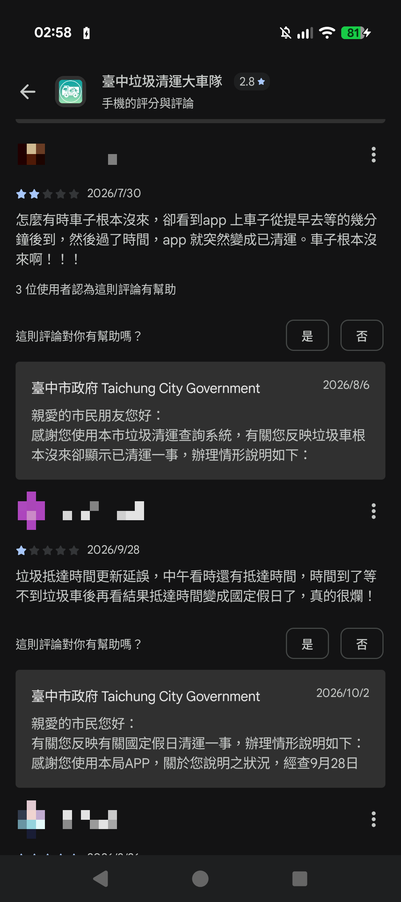
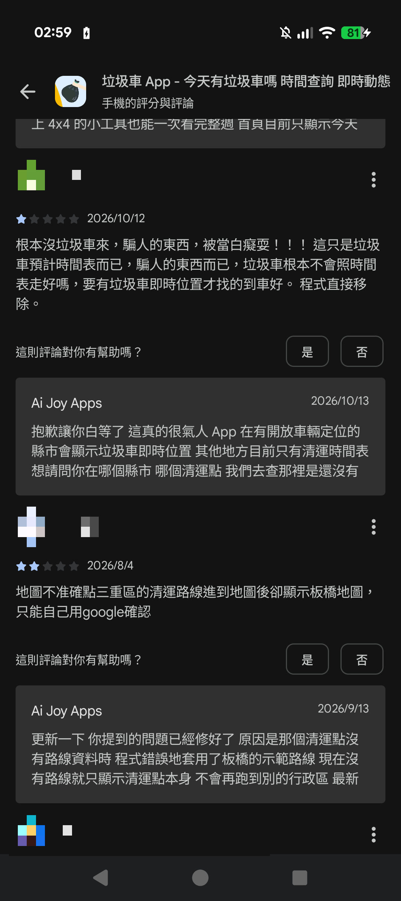

# 垃圾車 APP 評分與評論擷取紀錄（2026-11-07）

> **負責人：** D（勇嘉）
> **用途：** 作為 `docs/proposal/02-introduction.md` 中 [I2]、[I11] 的佐證資料。App Store 網頁只顯示少數評論，且評分會隨時間變動，因此在此保存擷取當下的統計與被引用的評論原文。
> **擷取時間：** 2026-11-07 00:16（台北時間）
> **原始資料：** 依 `docs/proposal/README.md` §5.1，原始 JSON 不放進 repo，保存在本機；本文件只放統計摘要與被引用的評論。

## 1. 擷取方法

| 項目 | 內容 |
|---|---|
| APP 基本資料 | iTunes Search API：`https://itunes.apple.com/lookup?id=<APP ID>&country=tw` |
| 評論 | App Store 評論 RSS：`https://itunes.apple.com/tw/rss/customerreviews/page=<1、2>/id=<APP ID>/sortby=mostrecent/json` |
| 範圍 | 臺灣區 App Store，依時間排序的最新評論，每頁 50 則，取第 1、2 頁共 100 則 |
| 限制 | 只有 iOS 版的 App Store 評論，不含 Google Play；RSS 只提供最新的評論，100 則不代表全部評論 |

任何人都可以用上面的網址重新擷取，但結果會隨新評論增加而改變。

## 2. APP 基本資料

| 項目 | 臺中垃圾清運大車隊（官方）[I2] | 垃圾車App - 今天幾點到（民間）[I11] |
|---|---|---|
| App Store ID | 935569593 | 1527915502 |
| 開發者 | Taichung City Government | CHEN GUAN-JHEN |
| 版本（擷取當下） | 2.63（2026-10-12） | 5.10.0（2026-10-22） |
| 首次上架 | 2014-11-18 | 2020-08-21 |
| 平均評分 | 2.555 | 4.292 |
| 評分數 | 609 | 9,683 |
| App Store 頁面 | <https://apps.apple.com/tw/app/id935569593> | <https://apps.apple.com/tw/app/id1527915502> |
| Google Play 頁面 | <https://play.google.com/store/apps/details?id=tw.gis.tgcar> | <https://play.google.com/store/apps/details?id=tw.garbagetruck.app> |

## 3. 最新 100 則評論的星等分布

| 星等 | 官方 APP | 民間 APP |
|---|---:|---:|
| 1 ★ | 71 | 73 |
| 2 ★ | 15 | 6 |
| 3 ★ | 6 | 7 |
| 4 ★ | 1 | 6 |
| 5 ★ | 7 | 8 |
| 評論日期範圍 | 2024-10-17 至 2026-10-27 | 2025-09-19 至 2026-11-05 |

## 4. 1 星評論的抱怨類型

以關鍵字粗略分類，同一則評論可能同時屬於多類。這只是用來說明抱怨集中在哪些方面，不是嚴謹的內容分析。

| 類型 | 關鍵字 | 官方（71 則 1 星） | 民間（73 則 1 星） |
|---|---|---:|---:|
| 時間不準／到站資訊錯誤 | 不準、準確、準時、時間、預估、預計、延遲、提早、早到、晚到、遲到、已離開、已清運、沒來 | 39 | 37 |
| 定位／GPS | 定位、GPS、位置 | 15 | 7 |
| 通知／提醒問題 | 通知、推播、提醒 | 9 | 2 |
| 讀取慢／當機 | 讀取、轉圈、當機、閃退、卡、進不去 | 5 | 7 |

## 5. App Store 評論範例

以下兩則為 App Store 評論 RSS 中的原文（含表情符號），作為第 4 節分類的例子，不列出評論者暱稱。

| APP | 日期 | 星等 | 版本 | 標題 | 內容 |
|---|---|---|---|---|---|
| 官方 | 2026-04-21 | 1 ★ | 2.61 | 更新後還是很難找到住家垃圾車的時間 | 更新後還是很難找到住家垃圾車的時間，除非已經知道車號 |
| 官方 | 2026-03-23 | 1 ★ | 2.61 | 時間完全不準確 | 看著清運時間提早下樓等垃圾車結果垃圾車已經離開了😑 |

## 6. Google Play 評論截圖（正文引用）

`02-introduction.md` 正文引用的評論來自 Google Play，以下截圖由本組於 2026-11-07 在 Android 手機上擷取。為保護評論者隱私，暱稱與頭像已打上馬賽克。

| APP | 日期 | 星等 | 內容（原文） | 截圖 |
|---|---|---|---|---|
| 官方 | 2026/7/30 | 2 ★ | 怎麼有時車子根本沒來，卻看到app 上車子從提早去等的幾分鐘後到，然後過了時間，app 就突然變成已清運。車子根本沒來啊！！！ | 圖 A |
| 官方 | 2026/9/28 | 1 ★ | 垃圾抵達時間更新延誤，中午看時還有抵達時間，時間到了等不到垃圾車後再看結果抵達時間變成國定假日了，真的很爛！ | 圖 A |
| 民間 | 2026/10/12 | 1 ★ | 根本沒垃圾車來，騙人的東西，被當白癡耍！！！ 這只是垃圾車預計時間表而已，騙人的東西而已，垃圾車根本不會照時間表走好嗎，要有垃圾車即時位置才找的到車好。 程式直接移除。 | 圖 B |

官方 APP 在 Google Play 的平均評分於擷取當下顯示為 2.8 顆星（見圖 A 上方），與 App Store 的 2.555 不同；正文引用評分時會註明平臺。

**圖 A** 「臺中垃圾清運大車隊」Google Play 評論，兩則評論下方均有臺中市政府的回覆。

**圖 B** 「垃圾車 App」Google Play 評論（Google Play 上的開發者名稱顯示為 Ai Joy Apps）。
